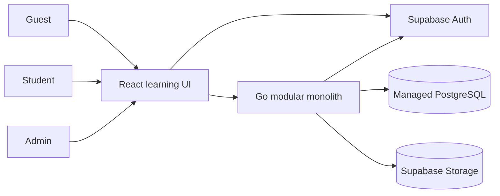
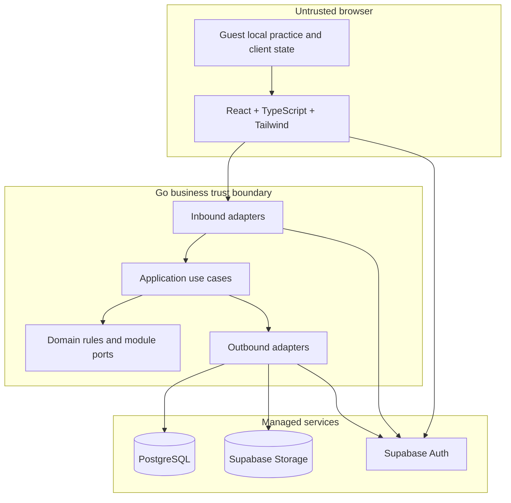

# DP-03 — Architecture Overview

| Metadata | Value |
|---|---|
| Package | DP-03 — Domain-Aligned Architecture & Data Contracts |
| Version | v0.1.0 |
| Status | **Draft — Not Approved** |
| Approval gate | AG-03 — **Not Approved** |
| Approved sources | [DP-01 Decision Registry](../DP-01/03-decision-registry.md) (G3-001–G3-003, FA-001–FA-006 B); [DP-02 rules](../DP-02/02-domain-rules-and-invariants.md) and [conditional AG-02 addendum](../DP-02/06-traceability-matrix.md) |

**Authority legend.** Product behavior cited from DP-01/DP-02 is approved within its stated gate boundary. Architecture choices labeled **Proposal** require AG-03 review. GAP-001/002/003/007 remain **Open** under conditional AG-02; dependent implementation is unauthorized. FA-007/008 remain Open for later gates. This is a logical architecture, not an API, schema, deployment plan, or implementation authorization.

## 1. System context and actors

Guest browses and reads every free flagship Lesson with local ungraded practice. Authenticated Student joins Paths, enrolls in Courses, creates official evidence, and manages own records. Admin authors and publishes content and performs explicitly authorized migrations or exceptional access actions. Supabase supplies managed identity, PostgreSQL and object storage; Go decides LMS authorization and business transitions. A privacy deletion request is an authenticated Student action followed by controlled cross-service processing ([RULE-002–RULE-006](../DP-02/02-domain-rules-and-invariants.md), FA-006 B).



*Logical system context; arrows show permitted integration roles, not final network topology.*

## 2. Logical containers and trust boundaries

| Boundary | Contract | Source / status |
|---|---|---|
| Browser ↔ Go | Browser submits intent and displays results. Go authenticates protected requests, checks account state, authorizes role/ownership, validates rules and commits official state. Browser flags and Guest local records cannot create official passing or completion. | G3-001, FA-002 B, RULE-006/009/010; approved behavior |
| Browser ↔ Supabase Auth | Supabase Auth establishes identity and issues credentials; the browser may use public client configuration for sign-in. Go independently verifies token integrity, issuer, audience, expiry and subject, then maps the subject to an internal account and active role state. | D-011, Q-006, G3-001; mapping is AG-03 proposal |
| Go ↔ PostgreSQL | One Go business authority owns writes through domain modules; shared database transactions support critical invariants. Module ownership restricts writes even with shared storage. | G3-001/002; module design proposal |
| Go ↔ Storage | Go authorizes object operations and issues narrowly scoped access when needed. Private Student objects are not publicly enumerable; privileged service credentials remain server-side. Public published media may be delivered through approved safe access paths. | G3-001/003, FA-006 B; access design proposal |
| Go ↔ Auth administration | Trusted server-side operation handles Admin bootstrap and account-deletion coordination. A valid browser token alone never grants Admin rights; deletion state gates future official access even if token remains cryptographically valid. | Q-006, FA-006 B; coordination proposal |



*Logical container architecture; no hosting vendor, scale target, network segmentation or recovery objective is selected (FA-008 Open).*

The Go monolith uses pragmatic hexagonal boundaries: domain rules define invariants; application use cases coordinate them; inbound adapters translate authenticated requests; outbound adapters implement persistence, Auth, Storage and audit. Interfaces belong at meaningful external or module boundaries, not around every function. The [module contract](02-module-boundaries-and-dependencies.md) defines ownership and dependency direction.

## 3. Primary flows

**Guest learning:** public catalog and free Lesson content are served without Student identity; local practice and recoverable position stay client-side until an explicit, safe post-login merge. Such records never become verified passing. Catalog visibility of archived items remains conditional on GAP-001.

**Authenticated learning:** Go verifies the Supabase token, resolves its internal Student identity and lifecycle state, checks ownership and the applicable pinned Course/Assessment version, then validates prerequisites and evidence. Protected-action coverage remains conditional on GAP-007. Official progress/completion and grades are written only through Go. Path progress reads global Course completion with Path participation and applicable version context; detailed Path migration remains conditional on GAP-002.

```mermaid
sequenceDiagram
  actor Student
  participant UI as React UI
  participant Auth as Supabase Auth
  participant Go as Go use case
  participant DB as PostgreSQL
  Student->>UI: Request official learning action
  UI->>Auth: Obtain current identity token
  Auth-->>UI: Token
  UI->>Go: Submit intent with token
  Go->>Auth: Verify token/signing context as configured
  Go->>DB: Resolve active account, role, pin and policy
  Go->>Go: Authorize and validate applicable rule
  alt accepted
    Go->>DB: Atomic official transition
    DB-->>Go: Committed state
    Go-->>UI: Authoritative result
  else rejected
    Go-->>UI: Safe reason; no official mutation
  end
  UI-->>Student: Show result or unmet condition
```

*Logical request flow; verification may use provider keys or trusted introspection as selected at AG-03/DP-04. It does not prescribe an endpoint or token transport.*

**Admin and privacy:** Admin actions require Go-side role and policy checks; publication, archive, migration and exceptional revocation are distinct use cases. An accepted account-deletion request invalidates access before asynchronous cleanup and reconciles PostgreSQL, Auth and Storage. Restore safeguards prevent deleted data from silently reappearing. See [lifecycle](04-data-lifecycle-and-retention.md) and [consistency design](05-consistency-and-transaction-design.md).

## 4. Failure, security and observability boundaries

| Concern | Architecture contract |
|---|---|
| Provider outage | Authentication failure denies protected mutations; public content may remain available only through an approved safe path. Storage failure does not turn missing evidence into completion. |
| Partial write | Critical local state transitions use one PostgreSQL transaction. External Auth/Storage work uses retry-safe orchestration and reconciliation, not a pretend cross-provider transaction. |
| Concurrency | Version pins, one active Attempt per Student/Assessment/Version, immutable grades and idempotent submissions are guarded at the authoritative write boundary. |
| Confidentiality | Least privilege, no privileged service credential in browser, private-object authorization, owner checks, redacted errors and minimized nonpersonal audit events. |
| Observability | Correlation IDs, outcome/reason codes, transaction/retry status, provider failure counts and deletion/migration reconciliation state; exclude tokens, answers, notes and personal payloads from logs. Numeric alert, SLO and retention parameters beyond FA-006 remain FA-008/FA-007. |

## 5. Approval boundary

AG-03 must review the proposed module/data/transaction choices in this package. Conditional AG-02 allows documentation based on approved rules but does not authorize implementation of unresolved GAP-001/002/003/007 detail. FA-006 B governs personal-data deletion while an account is active or being deleted; historical evidence protection does not override it. FA-008 owns hosting, capacity and recovery targets; FA-007 owns quantitative UX/performance targets.
