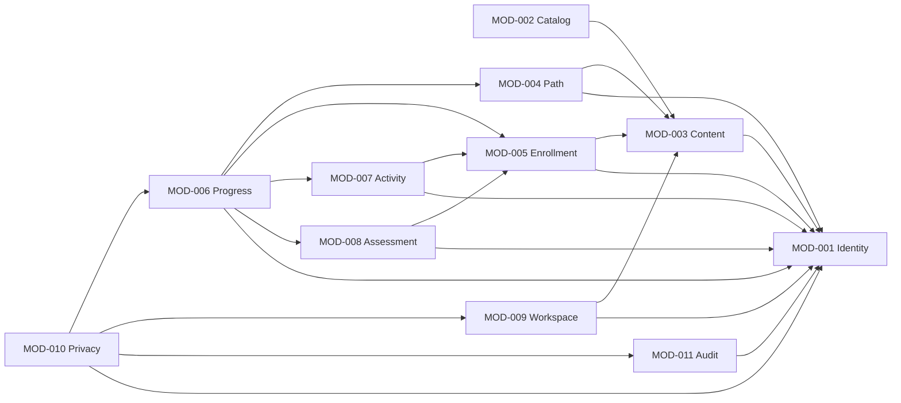

# DP-03 — Module Boundaries & Dependencies

| Metadata | Value |
|---|---|
| Package | DP-03 — Domain-Aligned Architecture & Data Contracts |
| Version | v0.1.0 |
| Status | **Draft — Not Approved** |
| Approval gate | AG-03 — **Not Approved** |
| Approved sources | [DP-01 G3-001/002/003 and FA-001–FA-006 B](../DP-01/03-decision-registry.md); [DP-02 domain rules](../DP-02/02-domain-rules-and-invariants.md); [conditional AG-02 addendum](../DP-02/06-traceability-matrix.md) |

**Proposal for AG-03:** These are cohesive logical modules inside one Go monolith, not separate services or required Go packages. Their data ownership and dependency direction are architectural proposals; cited product behavior is approved only within its governance boundary. See [overview](01-architecture-overview.md), [data model](03-logical-data-model.md), and [transaction contracts](05-consistency-and-transaction-design.md).

## 1. Proposed module contracts

Each capability below is an application-level operation, not an endpoint. “Depends on” means a read/capability port, never permission for arbitrary writes to another module's owned data. Every module owns authorization of its own command, using identity context from MOD-001; the inbound adapter also rejects unauthenticated protected requests.

| ID / module | Responsibility; owned concepts/data | Public application capabilities; dependencies | Authorization and explicit non-responsibility |
|---|---|---|---|
| MOD-001 Identity & Access | Internal account mapped to Supabase subject, role grants, lifecycle access state; account/role data. | Resolve verified actor, authorize role/owner, invalidate account access, trusted Admin bootstrap. No domain-module dependency; Supabase Auth is an outbound provider. | Owns active/deleting access gate and privileged role changes; never grades or decides Course eligibility. Q-006, G3-001, FA-006 B. |
| MOD-002 Catalog & Discovery | Public search/filter projection, discoverability labels; catalog read projection. | Search/browse and safe details; reads MOD-003 published summaries. | Enforces public visibility; never publishes, enrolls or decides exceptional revocation. Archived public listing is GAP-001. D-021, RULE-025. |
| MOD-003 Learning Content & Publishing | Paths, Course canonical identity, Course/Assessment-facing curriculum versions, Modules, Lessons, Blocks, revision/publication state, Path membership/version context and Course-completion prerequisite configuration; authored content. | Read eligible published snapshots; validate/preview/publish; normal archive/unpublish; consult MOD-001 for Admin authorization. | Owns authoring and publication invariants; never alters pinned enrollments or Student achievements. Exceptional revocation policy is coordinated separately, GAP-001. D-012/015, RULE-020/021/028. |
| MOD-004 Path Participation | Authenticated join and official participation records. | Join/read participation; reads MOD-001 actor and MOD-003 Path identity/version. | Never enrolls member Courses or calculates canonical Course completion. Path leave/migration details remain GAP-002. FA-004 B, RULE-002/012. |
| MOD-005 Course Enrollment | Student intent, one applicable enrollment, pinned published Course version, access-eligibility state and controlled migration record. | Enroll/resume, inspect pin, authorized manual migration, apply exceptional access policy; reads MOD-001 and MOD-003. | Owns pin changes and enrolled-access checks; never manufactures evidence. Revocation parameters GAP-001, target eligibility GAP-003. FA-005 B, RULE-003/004/022/029. |
| MOD-006 Progress & Completion | Official Lesson/Course/Path completion records and derived progress views; canonical Course achievement. | Evaluate/record completion; derive preview/official Path progress; reads MOD-001/003/004/005/007/008. | Go-side proof check; never accepts browser flags as passing or writes another module's evidence. Detailed Path curriculum migration GAP-002, protected prerequisite action coverage GAP-007. Q-004, RULE-010–014/030. |
| MOD-007 Interactive Activity Evidence | Server participation and verified non-assessment activity evidence under published requiredness; activity evidence records. | Validate/record tiered activity evidence; reads MOD-001/003/005. | Owns tier validation; never treats local Guest interaction as server passing or issues graded assessment Result. FA-002 B, RULE-008/009. |
| MOD-008 Assessment | Assessment definition/version policy reference, version-locked Attempts, Submissions, immutable Results and graded passing evidence; assessment records. | Start/resume/expire/abandon/submit/retry; reads MOD-001/003/005. | Owns attempt uniqueness, expiry, retry accounting and grading; never edits prior Results. Abandonment trigger and compatibility detail GAP-003. FA-003 B, AG02-04. |
| MOD-009 Student Workspace | Student notes, bookmarks, preferences and resume pointers; own workspace records. | Read/edit/remove own records; reads MOD-001 and MOD-003 content identity. | Own-record checks; never changes official completion. D-019/024, RULE-024. |
| MOD-010 Privacy & Account Lifecycle | Deletion request/case, workflow state and reconciliation evidence; orchestration record. | Validate/accept request, start/retry/reconcile cleanup, report policy-safe state; invokes each owner's deletion/de-identification capability and trusted Auth/Storage adapters. | Only authenticated account owner can request; operator retries do not bypass policy. No direct cross-module table writes or self-service recovery after effective deletion. FA-006 B. |
| MOD-011 Administration & Audit | Minimal nonpersonal security/privileged-action audit records and audit retention; privileged action review. | Record authorized action outcome, read scoped audit, enforce 180-day security-audit lifecycle; reads MOD-001 actor/role context. | Admin scope is checked; audit never becomes an alternate route to mutate grades or keep personal payloads. Q-006, G3-003, FA-006 B. |

**Events:** Core enrollment, passing and completion decisions are synchronous; an event cannot be the sole proof of those results. A durable publication or completion notification may update MOD-002/MOD-006 read projections, and a durable deletion work item may coordinate external cleanup. Each consumer is idempotent and reconciles against authoritative owner state. This event mechanism is a proposal; no event bus or message broker is required. Audit capture must be atomic with the action where its absence would violate an auditable policy; external delivery can follow a durable local record.

## 2. Dependency direction and interaction matrix

Domain rules depend on no adapter. Application use cases call owner capabilities via narrow interfaces; inbound/outbound adapters depend inward. The diagram shows principal dependency arrows; the module table and interaction matrix are authoritative for the complete logical dependencies, and none may point back to a caller. MOD-010 is a top-level deletion coordinator; other modules use MOD-001 account state for access control and implement their own cleanup capability. MOD-011 audit receives durable action records through an application/audit port and does not call business modules.

*Selected logical dependencies; omitted arrows, including MOD-010 to other data owners, follow the same owner-capability pattern and never authorize direct data access.*

| Caller → owner | Interaction | Consistency boundary / restriction |
|---|---|---|
| MOD-002 → MOD-003 | Published catalog summary and discoverability | Projection may lag; authorization and current publication state are rechecked before protected action. GAP-001 controls archival listing. |
| MOD-004 → MOD-003 | Validate Path and applicable version on join | Participation write belongs only to MOD-004; no Course enrollments. |
| MOD-005 → MOD-003 | Check eligible Course version on enroll/migrate | Pin and eligibility check share an authoritative transaction/snapshot where possible; no silent pin update on publish. |
| MOD-007/008 → MOD-005/003 | Verify enrollment pin, published policy and assessment/activity version | Evidence is bound to the checked context; stale/mismatched write rejected. |
| MOD-006 → MOD-004/005/007/008/003 | Read participation, pin, evidence and policy for completion | Completion owner validates a coherent snapshot and writes achievement atomically; Path view reuses global Course completion. |
| MOD-010 → each data owner | Invoke policy-scoped delete/de-identify and report result | Owner controls its records; coordinator retries/reconciles. Account access is invalidated first via MOD-001. |
| Any privileged use case → MOD-011 audit port | Capture minimal audit outcome | Required audit record is durable with action; no personal payload or unrestricted cross-module write. |

## 3. Specific cross-module invariants

- **Reusable completion:** MOD-006 owns one canonical Course achievement per Student and applicable policy/version context. Path progress reads it with MOD-003 membership and MOD-004 participation. Changing Path membership never duplicates or erases Course achievement; previously earned official Path completion remains protected (FA-004 B, AG02-02).
- **Version pinning:** MOD-003 publishes versions; MOD-005 pins one eligible version per enrollment. MOD-007/008/006 use that pin when validating evidence and completion. Publishing alone sends no migration command; MOD-005 changes pins only through authorized audited migration (FA-005 B, AG02-03).
- **Archive and revocation:** MOD-003 changes normal publication state; MOD-005 enforces new-enrollment denial and retained eligible pinned access. Exceptional revocation is a distinct authorized audited command; exact policy parameters stay conditional (GAP-001).
- **Deletion:** MOD-010 orchestrates MOD-001 access invalidation, owner cleanup, Auth/Storage cleanup and backup restore safeguards. A failed provider step leaves a retryable case, never a reinstated active account. Privacy policy takes precedence over retaining personal historical evidence after account deletion (FA-006 B).
- **Open contracts:** Path leave/curriculum migration (GAP-002), evidence equivalence/target eligibility/abandonment trigger (GAP-003), and protected prerequisite action list (GAP-007) are not filled by module design. FA-007/008 do not supply numeric service or deployment parameters here.
