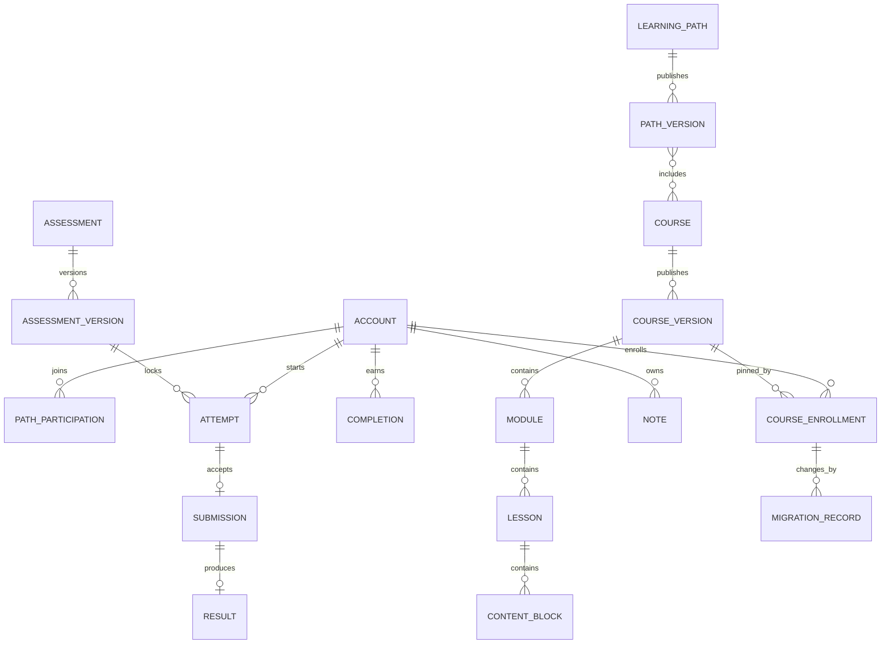

# DP-03 — Logical Data Model

| Metadata | Value |
|---|---|
| Package | DP-03 — Domain-Aligned Architecture & Data Contracts |
| Version | v0.1.0 |
| Status | **Draft — Not Approved** |
| Approval gate | AG-03 — **Not Approved** |
| Approved sources | [DP-01 registry](../DP-01/03-decision-registry.md) (G3-001/003, FA-001–FA-006 B); [DP-02 domain model](../DP-02/01-domain-model-and-glossary.md), [rules](../DP-02/02-domain-rules-and-invariants.md), [conditional AG-02 addendum](../DP-02/06-traceability-matrix.md) |

**Proposal for AG-03:** Entity names, ownership and logical constraints below are architecture proposals, not SQL tables, fields, indexes or migration instructions. Stable `ENT` IDs name logical records; approved product decisions retain their own IDs. `P` means Student-linked personal data; `L` means sensitive learning evidence while linked; `I` means internal operational data; `C` means public content. A record can have multiple classes. FA-006 B controls deletion/de-identification and the [lifecycle contract](04-data-lifecycle-and-retention.md) controls timing. No category below is granted indefinite retention.

## 1. Logical entities and ownership

| ID | Entity / owner | Identity, relationship, mutable boundary | Class / disposition dependency |
|---|---|---|---|
| ENT-001 | Account / MOD-001 | Internal Student/Admin identity maps to one Supabase Auth subject; lifecycle state ACTIVE → deletion-restricted → completed, with idempotent request handling. External subject is not business authority by itself. | P; delete/minimize under FA-006 B; access invalidated on accepted request. |
| ENT-002 | Role Grant / MOD-001 | Authorized grants associate Account with Student/Admin role; privileged bootstrap requires trusted operation and audit. | P/I; remove with account under FA-006 B unless legitimate policy applies. |
| ENT-003 | Learning Path / MOD-003 | Canonical Path identity with discoverability and publication context. | C/I; personal attribution, if any, follows FA-006 B. |
| ENT-004 | Path Version & Membership / MOD-003 | One published Path policy/version identifies applicable member Course identities and validity context; membership changes create prospective context, not rewritten achievements. | C/I; detailed migration/leave GAP-002. |
| ENT-005 | Course / MOD-003 | Canonical Course identity reusable across Paths; not a copy per Path. | C/I. |
| ENT-006 | Course Version / MOD-003 | Distinct published curriculum/policy snapshot and publication state; existing enrollment pin is separate. | C/I; historical availability subject to access policy, FA-006 B and GAP-001. |
| ENT-007 | Module / MOD-003 | Ordered child of one Course Version. | C/I. |
| ENT-008 | Lesson / MOD-003 | Child of one Module with policy-aware requiredness. | C/I. |
| ENT-009 | Content Block / MOD-003 | Typed authored Lesson content/interaction from approved MVP block set. | C/I; private media references may require protected access. |
| ENT-010 | Content Draft / Revision / MOD-003 | Mutable draft and revision history distinct from published Course Version. Publishing freezes a new version. | I; personal attribution follows FA-006 B. |
| ENT-011 | Path Participation / MOD-004 | Authenticated Student joins a Path; distinct from Course Enrollment. Official participation identifies applicable Path context. | P; delete/de-identify under FA-006 B; leave detail GAP-002. |
| ENT-012 | Course Enrollment / MOD-005 | Student intent links Account, canonical Course and one pinned eligible Course Version; pin changes only by authorized migration. | P; delete/de-identify under FA-006 B. |
| ENT-013 | Progress View / MOD-006 | Recomputable view of authoritative evidence/completion with Course/Path policy context; preview is explicitly unofficial. | P/L when linked; purge/recompute after deletion, never independent proof. |
| ENT-014 | Completion Record / MOD-006 | Immutable earned Lesson/Course/Path achievement, with subject, canonical target, applicable version/policy and earned context. Course achievement is global across Paths. | P/L; preserved while active, then delete or irreversibly de-identify per FA-006 B. |
| ENT-015 | Activity Evidence / MOD-007 | Server-recorded participation or verified passing for a Student, activity and applicable published version; local Guest interaction is not this entity. | P/L; delete or irreversibly de-identify under FA-006 B. |
| ENT-016 | Assessment / MOD-008 | Canonical graded assessment identity associated with authored Course context. | C/I. |
| ENT-017 | Assessment Version / MOD-008 | Frozen questions, weights, threshold and retry/expiry policy used for version-locked grading. | I/C; no unapproved numeric thresholds except 24-hour default Attempt expiry. |
| ENT-018 | Attempt / MOD-008 | Student + Assessment + Assessment Version context; ACTIVE or terminal SUBMITTED/EXPIRED/ABANDONED; default expiry 24 hours. | P/L; terminal history immutable while retained, deletion policy applies. |
| ENT-019 | Submission / MOD-008 | Answers attached to one Attempt; same-attempt submission is idempotent and cannot replace accepted answers. | P/L; delete/de-identify under FA-006 B. |
| ENT-020 | Result / MOD-008 | One immutable accepted grade per submitted Attempt and locked Assessment Version. | P/L; delete/de-identify under FA-006 B. |
| ENT-021 | Passing Evidence / MOD-008 | Verified pass reference tied to an immutable Result; later retry outcomes do not revoke it. | P/L; delete/de-identify under FA-006 B. |
| ENT-022 | Course-Completion Prerequisite / MOD-003 | Optional authored reference from a Course policy to another canonical Course's completion. | I/C; only Course-completion type in MVP; protected actions GAP-007. |
| ENT-023 | Note / MOD-009 | Student-owned text associated with learning context. | P; delete on accepted deletion lifecycle. |
| ENT-024 | Bookmark / MOD-009 | Student-owned pointer to content/position. | P; delete on accepted deletion lifecycle. |
| ENT-025 | Preference / MOD-009 | Student-owned reading/display setting. | P; minimize/delete under FA-006 B. |
| ENT-026 | Security Audit Event / MOD-011 | Minimal operation, outcome, time and nonpayload accountability reference; protected actor mapping, if needed, is separate and policy-bound. No tokens, answers, notes or personal payloads in log body. | I with possible protected linkability; 180-day retention unless legitimate legal obligation requires otherwise. |
| ENT-027 | Deletion Case / MOD-010 | Valid request, acceptance, access-invalidation and per-owner/provider work status; idempotent retries and nonpersonal completion evidence. | P while linkable; minimize/delete link after closure per policy; do not use as recovery credential. |
| ENT-028 | Version Migration Record / MOD-005 | Authorized Admin action identifies source/target eligible published versions, affected enrollments, outcome, learner notice and audit reference. | P/I while linked; FA-006 B applies; compatibility GAP-003. |
| ENT-029 | Evidence Compatibility Map / MOD-005 | Explicit source evidence → target requirement correspondence and verified compatibility decision for migration. It cannot itself create a new pass. | P/L while linked; FA-006 B applies; criteria GAP-003. |
| ENT-030 | Storage Object Reference / owning module | Logical reference to public content media or private Student-owned object; object body remains in Supabase Storage, access classified by owner. | C or P; private object deletion and restore reconciliation under FA-006 B. |
| ENT-031 | Guest Local State / browser only | Optional local position, draft or settings before explicit authenticated recovery; no server-side official identity or evidence. | Local personal data where present; browser clear/recovery boundaries; never promoted to passing. |

## 2. Relationships and cardinality

*Logical ER view. The `PATH_VERSION` ↔ `COURSE` relationship is many-to-many membership, not Course duplication. Other entities and association context are specified in the table; this diagram is deliberately selective.*

- One Account may own many Path participations and Course enrollments; a Course enrollment points to exactly one current pinned Course Version at a time. Its historical pin changes are recorded, never inferred from publication.
- One canonical Course may belong to many Path Versions. Path participation does not create Course enrollment. Official Path progress combines the applicable Path Version, participation and globally reusable Course completion; preview must remain unofficial (FA-004 B, AG02-02).
- One Course Version contains its Modules, Lessons and Blocks. An Assessment Version and Course completion policy are resolved within the pinned published learning context. Exact assessment-to-course reuse and Path migration remain proposal/open boundaries, not new product policy.
- Each Attempt belongs to exactly one Student, Assessment and Assessment Version. At most one ACTIVE Attempt exists per exact triple. An accepted submission has one immutable Result; expired/abandoned Attempts have no scored Result by transition alone (AG02-04).
- A prerequisite references another canonical Course completion, including across Paths. It never references a score/skill/time expression in MVP (AG02-05).
- A Migration Record identifies source/target versions and affected enrollment(s), with explicit evidence mapping. Source evidence and completion retain their historical context; incompatible/unmapped target requirements stay unmet (AG02-03).

## 3. Logical uniqueness, reference and mutation contracts

| Contract | Required invariant / authority |
|---|---|
| Identity | A verified Supabase subject resolves to at most one active internal Account mapping; Admin privilege comes from Go-owned authorized grant, not browser claim. MOD-001. |
| Path participation | An accepted repeated join for the same Student/Path/applicable participation context is idempotent; it cannot create member Course enrollments. MOD-004. |
| Enrollment | Repeated intent for Student and canonical Course cannot produce conflicting current pins. New enrollment chooses the latest **eligible** published version; archive/unpublish blocks new enrollment unless separately approved policy permits. MOD-005. |
| Course completion | No duplicate canonical Course achievement merely because multiple Paths include it. Retained earned records are append/protect; prospective policy changes do not overwrite them. MOD-006. |
| Attempt/grade | One ACTIVE Attempt per Student/Assessment/Assessment Version; locked version cannot change; terminal Attempt/accepted Submission/Result are immutable while retained; retries count expired/abandoned when policy applies. MOD-008. |
| Evidence | Server participation, verified passing and local interaction are distinct. A compatibility map only recognizes previously verified source evidence; no map manufactures grade/passing. MOD-007/008/005. |
| Publication | Draft changes never mutate a published Course Version or existing enrollment pin. Normal archive is distinct from exceptional revocation. MOD-003/005. |
| Privacy | Accepted deletion gates access before cleanup; each owner disposes of its Student-linked data under FA-006 B, and restores cannot silently resurrect it. MOD-010 coordinates, owners execute. |

The physical choice of constraints, identifiers, storage layout and isolation is deferred to approved implementation design. Logical rules above must be enforced at authoritative write boundaries; a read model or UI check alone is insufficient. See [transaction design](05-consistency-and-transaction-design.md).
