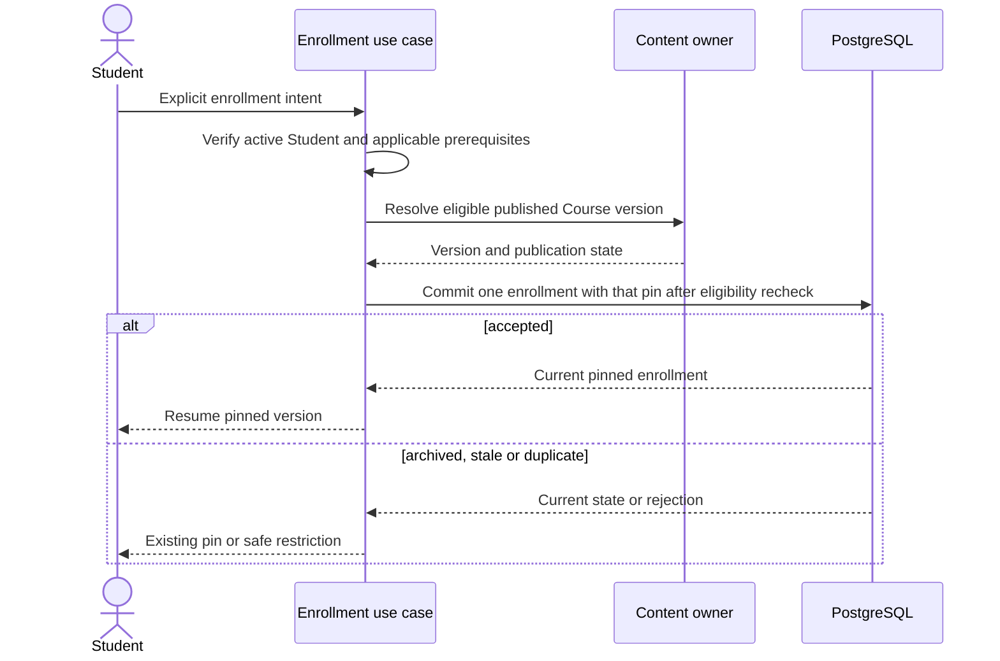

# DP-03 — Consistency & Transaction Design

| Metadata | Value |
|---|---|
| Package | DP-03 — Domain-Aligned Architecture & Data Contracts |
| Version | v0.1.0 |
| Status | **Draft — Not Approved** |
| Approval gate | AG-03 — **Not Approved** |
| Approved sources | [DP-01 FA-001–FA-006 B and G3-001/002](../DP-01/03-decision-registry.md); [DP-02 RULE-001–RULE-031](../DP-02/02-domain-rules-and-invariants.md), [AC-001–AC-067](../DP-02/05-acceptance-criteria.md), [conditional AG-02 addendum](../DP-02/06-traceability-matrix.md) |

**Proposal for AG-03:** A “local transaction” means one authoritative PostgreSQL commit coordinated by Go, not a chosen SQL isolation level or physical constraint. A command must recheck its preconditions at its write boundary and give the same observable result on safe retry. Cross-provider work is a durable, retryable workflow; no Auth/Storage/PostgreSQL distributed transaction is claimed. Unresolved GAP-001/002/003/007 detail remains conditional and unauthorized for implementation.

## 1. Critical operation contracts

| ID / operation | Owner and transaction boundary | Preconditions and invariant | Concurrency / idempotency | Failure and recovery |
|---|---|---|---|---|
| TX-001 Path join | MOD-004; local participation write. | Verified active Student, eligible Path; join creates official participation only, no member Course enrollment (RULE-002). | Same Student/Path/applicable context joins once; repeated intent returns existing state. | Reject invalid actor/Path without mutation; reconcile duplicate requests from owner record. |
| TX-002 Course enrollment | MOD-005; local enrollment/pin write with coherent MOD-003 eligibility check. | Explicit Student intent, eligible published Course version; pin latest eligible version; archive/unpublish denies new enrollment unless separately approved policy (RULE-003/004/028). | Concurrent intents converge on one current enrollment; publication/archive race is resolved by authoritative eligibility check at commit. | Reject stale/ineligible version; retry by rereading current state, never silently choose draft. |
| TX-003 Course publish | MOD-003; local frozen version/publication transition plus durable audit obligation. | Authorized Admin, validated draft; new published version does not mutate old version or existing pins (RULE-020/021). | Concurrent edits/publish require explicit current revision check; repeated publish intent cannot create an unintended second version. | Validation/authorization failure leaves prior version; repair projection from owner state. |
| TX-004 Normal archive/unpublish | MOD-003 publication state plus MOD-005 eligibility read; local auditable transition. | Authorized Admin; no new enrollment; eligible existing pinned access continues (RULE-028). | Enroll/archive race resolves against committed state; repeated state change is harmless. | Unauthorized/failed action leaves prior state; read access eligibility separately. Catalog listing remains GAP-001. |
| TX-005 Exceptional revocation | MOD-005 access policy command; local authorized auditable transition, distinct from TX-004. | Explicit authorized policy; preserve completion/Results/passing (RULE-029). | Recheck policy and affected access at commit; repeated command cannot duplicate adverse effect. | Deny missing policy/authorization; reconcile audit and access state. Exact policy parameters GAP-001. |
| TX-006 Activity evidence | MOD-007; local evidence write. | Active Student, pinned policy/version, valid activity tier; browser/local click cannot become passing (RULE-008/009). | Duplicate evidence intent converges; version/requiredness checked at write. | Reject invalid/local-only proof; re-read authoritative evidence before completion. |
| TX-007 Attempt start | MOD-008; local Attempt write. | Eligible active Student, locked Assessment Version, no ACTIVE Attempt for exact Student/Assessment/Version (RULE-016). | Atomic uniqueness effect; concurrent starts return same active Attempt or one wins safely. | Recheck eligibility and retry by reading current active Attempt. |
| TX-008 Attempt expiry/abandonment | MOD-008; local terminal transition. | ACTIVE reaches configured expiry (default 24 hours) or approved abandonment trigger; terminal record remains and counts under applicable retry policy (RULE-017). | Submit/expire race has one winning terminal transition; repeated terminalization is idempotent. | Stale transition rejected; reconcile time/state. Abandonment trigger GAP-003. |
| TX-009 Submission and grading | MOD-008; accepted answers, terminal Attempt and immutable Result in one local transaction. | ACTIVE, unexpired, matching locked version, valid submission; same Attempt submission idempotent (RULE-018). | Concurrent/duplicate submit returns same Result if equivalent; conflicting or late duplicate rejected without overwriting. | Roll back whole local result on failure; unknown outcome resolved by Attempt lookup before retry. |
| TX-010 Retry accounting | MOD-008; local eligibility check and new Attempt write. | Submitted, expired and abandoned attempts counted as configured; prior passing/grades survive (RULE-019). | Concurrent retry/start cannot create two ACTIVE Attempts in same exact context; count from authoritative history. | Reject when policy disallows; no numeric retry limit or new threshold invented. |
| TX-011 Course/Lesson completion | MOD-006; coherent evidence/policy read and local append/protect achievement. | Explicit Student completion action; applicable pin, required activities/assessments and protected prerequisite validated by Go (RULE-010/011). | Concurrent completion requests converge on one canonical achievement per applicable context; reread evidence/version before commit. | Missing/stale proof returns unmet conditions; never infer pass from UI or partial write. Prospective FA-001 protects earned records. |
| TX-012 Path progress/completion | MOD-006; official completion write where earned, otherwise derived read. | Official state requires MOD-004 participation and applicable member Courses; global Course completion reusable; preview unofficial (RULE-012/030). | Recompute from authoritative membership/version and Course achievements; repeated completion cannot duplicate earned Path record. | Stale projection corrected from owners. Detailed curriculum migration/leave GAP-002. |
| TX-013 Path membership publish | MOD-003; local prospective Path version/membership transition. | Authorized publication; change does not erase global Course or already earned Path completion (RULE-013/030). | Serialize conflicting revisions; no retroactive overwrite. | Roll back invalid publish; reconcile progress projections. Detailed migration GAP-002. |
| TX-014 Prerequisite validation | MOD-006 or owning official-action use case; inside that protected action's authoritative transaction. | Optional Admin-configured prerequisite references another Course's global completion; Go blocks unmet applicable action (RULE-005). | Reread canonical completion and policy at action boundary; no browser-only bypass. | Reject with missing Course, no mutation. Exact protected-action set GAP-007. |
| TX-015 Controlled Course migration | MOD-005; local pin change, source/target/mapping record and durable notice/audit obligation. | Explicit Admin authorization, eligible published target, affected enrollments and compatible verified-evidence mapping; incompatible/unmapped target requirements remain unmet (RULE-022/031). | Lock/compare current pin; repeated request is idempotent; conflicting target rejected. | Failure leaves old pin/evidence. Reconcile notice delivery and mapping outcome; never manufacture passing. Compatibility/target detail GAP-003. |
| TX-016 Deletion acceptance | MOD-010 with MOD-001; one local case/account restriction transaction. | Valid authenticated own-account request; invalidate Go access on acceptance; 30-day active-data clock starts at valid request (FA-006 B). | Same request/account maps to one case; concurrent official actions recheck account state at commit. | Invalid request no state change; a provider outage cannot reopen accepted access. |
| TX-017 Deletion cleanup | MOD-010 coordinator; owner-local cleanup steps plus retry-safe Auth/Storage operations. | Delete profile/notes/bookmarks; delete or irreversibly de-identify Student-linked learning data by applicable policy; reconcile backup expiry and restore guard (FA-006 B). | Per-step idempotency and recorded outcomes; no cross-provider atomicity assumption. | Keep account restricted; retry/reconcile until verified. Do not mark complete on soft deletion or missed 30-day target. |
| TX-018 Privileged audit | MOD-011 audit port with owning command's durable local record. | Author/publish/migrate/revoke/Admin bootstrap must leave auditable outcome where approved; security audit minimized and retained 180 days unless legitimate legal obligation (FA-006 B). | Duplicate action ID does not create conflicting audit outcome. | If required audit cannot be durably captured, privileged command fails or remains unresolved for safe reconciliation. No personal payload logged. |
| TX-019 Guest recovery | MOD-001/009 and relevant owner; local merge per eligible class. | Authenticated Student explicitly selects local position/drafts/settings; no browser passing/completion import (RULE-007). | Repeated merge safely converges without overwriting authoritative evidence. | Conflict preserves server state and allows safe user resolution. |
| TX-020 Admin bootstrap | MOD-001 with MOD-011 audit; trusted nonpublic operation. | Verified existing Supabase subject and explicit privileged authorization; public self-service cannot grant Admin (RULE-026). | One-time grant effect; repeat returns recorded outcome. | Reject missing authorization/audit, preserve prior roles. |

The owner controls its writes even when several logical records share PostgreSQL. Where a workflow spans modules, one application use case coordinates owner capabilities and a local transaction only for records that can truly commit together. Read projections may lag; protected commands recheck owner state. The [module contract](02-module-boundaries-and-dependencies.md) specifies dependency direction; the [logical data model](03-logical-data-model.md) specifies record identity.

## 2. High-risk flow sketches



*TX-002: latest eligible version is chosen for new enrollment; TX-003 publish never rewrites an existing pin. The exact prerequisite-protected action set is GAP-007.*

```mermaid
sequenceDiagram
  actor Student
  participant Go as Assessment owner
  participant DB as PostgreSQL
  Student->>Go: Start or resume version V
  Go->>DB: Atomically get/create one ACTIVE Attempt for S/A/V
  DB-->>Go: Attempt locked to V
  Student->>Go: Submit answers for Attempt
  Go->>DB: Check ACTIVE, expiry and locked V; commit answers and Result once
  alt valid first submission
    DB-->>Go: Immutable Result
    Go-->>Student: Grade and passing status
  else duplicate or terminal race
    DB-->>Go: Existing Result or terminal status
    Go-->>Student: Same Result or safe rejection
  end
```

*TX-007–TX-010: expiry/abandonment remain terminal history and enter applicable retry accounting; an earlier passing Result remains valid. No numeric retry limit is selected.*

```mermaid
sequenceDiagram
  actor Admin
  participant Go as Migration use case
  participant DB as PostgreSQL
  participant Notice as Learner notice delivery
  Admin->>Go: Select source, target, enrollments and explicit mapping
  Go->>Go: Check authorization, target and verified compatibility
  Go->>DB: Atomically compare pin and record target pin, mapping, audit/notice obligation
  alt committed
    DB-->>Go: Migration record
    Go->>Notice: Deliver durable notice of version and new requirements
    Notice-->>Go: Delivery outcome for reconciliation
    Go-->>Admin: Recorded outcome and notice state
  else stale or invalid
    DB-->>Go: Rejected; original pin/evidence intact
    Go-->>Admin: Explain rejection
  end
```

*TX-015: original evidence and completion remain protected while the account is active; FA-006 B governs later account deletion. Exact compatibility criteria and target eligibility beyond approved status are GAP-003.*

## 3. Conditional and later-gate boundaries

- **GAP-001 Open:** TX-004/005 cannot infer public listing, exceptional revocation parameters or a general Admin power to delete content. Normal archive alone never revokes eligible pinned access.
- **GAP-002 Open:** TX-012/013 preserve prior earned achievements but do not define Path leave or curriculum-version migration algorithm.
- **GAP-003 Open:** TX-008/015 do not invent an abandonment trigger, automatic evidence equivalence or target eligibility criteria beyond explicit authorized published target.
- **GAP-007 Open:** TX-014 enforces Course-completion prerequisites only for applicable protected official actions; the exact list and edge cases require later approval.
- **FA-007/008 Open:** No latency, capacity, RPO/RTO, hosting or alert threshold is chosen. FA-006 B's 30/30/180-day targets are approved privacy policy, not a general operational SLA.
