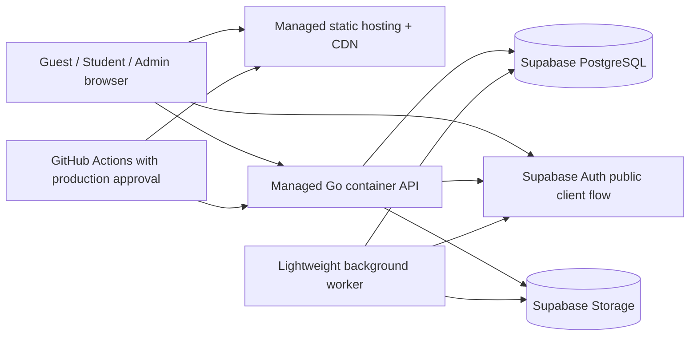

# DP-04 — Infrastructure & Deployment Operations

| Metadata | Value |
|---|---|
| Package | DP-04 — API, Security & Operations Contracts |
| Version | v0.1.0 |
| Status | **Draft — Not Approved** |
| Approval gate | AG-04 — **Not Approved** |
| Approved sources | [FA-008 B and INF-01–INF-14](../DP-01/03-decision-registry.md); [FA-006 B/B1](../DP-01/04-open-decisions-register.md); [DP-03 overview](../DP-03/01-architecture-overview.md), [privacy lifecycle](../DP-03/04-data-lifecycle-and-retention.md) and [AG-03 addendum](../DP-03/06-architecture-decisions-and-traceability.md) |

**Authority:** FA-008 B approves a Balanced Production MVP direction. `OPS` rows below are **derived/proposed operational contracts for AG-04 review**; they are not deployment manifests or a selected cloud SKU. Singapore is only a conditional preferred region until legal and latency validation. No specific Go host, paid tier, instance size, commercial SLA, numeric RPO/RTO, capacity or alert threshold is approved. FA-007 still owns quantitative performance/beta thresholds.

## 1. Logical production topology

*Logical topology only. Public/private network design, region and provider identity remain implementation design subject to AG-04 and INF-05 validation. Browser access to Auth does not authorize direct CRUD of core LMS data; Go controls business state.*

## 2. FA-008 B operational controls

| ID / approved input | Derived contract and control owner | Verification evidence required later |
|---|---|---|
| OPS-001 / INF-01 | Frontend owner deploys built React assets to managed static hosting/CDN; content version and rollback identity are recorded. No privileged secrets in bundle. | Artifact/CDN publish and rollback demonstration; browser-bundle secret scan. |
| OPS-002 / INF-02 | Backend owner runs the Go modular monolith as managed container deployment, with health/readiness and pragmatic scaling. No Go provider or instance size selected. | Container health, restart and scale-out drill on chosen provider. |
| OPS-003 / INF-03 | Data owner uses Supabase managed PostgreSQL; module write ownership and transaction invariants remain Go-enforced. | Environment isolation, connection privilege and restore verification. |
| OPS-004 / INF-04 | Identity/storage owners use Supabase Auth and Storage; Go validates identity and authorizes protected object access. | Token/role and private-object boundary tests. |
| OPS-005 / INF-05 | Region owner treats Singapore as **conditional preference** only; final location requires legal/privacy and representative latency validation. | Documented validation and Product Owner disposition before final region selection. |
| OPS-006 / INF-06 | Isolate Local, Staging and Production data, Auth, Storage, secrets and deploy permissions. Do not copy production personal data into nonproduction without approved irreversible de-identification. | Environment/resource inventory and cross-environment credential denial. |
| OPS-007 / INF-07 | GitHub Actions performs build/verification; production deployment has explicit human approval and recorded artifact identity. | Workflow run, approval and release record. No workflow config created here. |
| OPS-008 / INF-08 | Managed secret store supplies service credentials at runtime; least privilege, rotation and no source-control/browser exposure. | Secret scan, access review and rotation drill. |
| OPS-009 / INF-09 | Structured logs with request correlation, basic metrics and error alerts; separate minimized security audit stream. | Dashboard/alert routing and redaction review; numeric thresholds remain later policy. |
| OPS-010 / INF-10 | Lightweight worker executes deletion/reconciliation and other durable background obligations without requiring Kafka or a new service boundary. | Retry, duplicate and stuck-job drill. |
| OPS-011 / INF-11 | Backup inventory, expiry, tested restoration and deletion-suppression/replay must meet FA-006 B/B1. A managed backup feature alone is insufficient proof. | Backup-expiry evidence within 30 days; isolated restore proving no deleted personal-data resurrection. |
| OPS-012 / INF-12 | Operate best-effort MVP availability; publish no commercial SLA or invented uptime percentage. | Documented incident handling and recovery exercise, not an SLA claim. |
| OPS-013 / INF-13 | Use pragmatic horizontal scaling where supported; no Kubernetes, microservice split or distributed broker requirement. | Chosen-platform scale and resource-limit observation; capacity target remains unapproved. |
| OPS-014 / INF-14 | Set budget alerts, resource controls and cost review ownership on chosen managed services. | Alert receipt, cost dashboard and response record; no currency ceiling invented. |

## 3. Environments, delivery and rollback

| ID | Proposed operational contract |
|---|---|
| OPS-015 Environment security | Separate Supabase project/configuration and service identities for each environment. Production secrets and private data stay production-scoped; local/staging use safe sample data. TLS terminates public traffic, protected provider connections use approved transport, and DB/Storage credentials are least-privileged. Public exposure is limited to the web and Go surfaces actually needed. |
| OPS-016 Release sequence | Record source revision, dependency/build/test outcome, artifact identity, approved DP gate references, migration compatibility assessment and deployment approver. Deploy/verify Staging first. Production approval gates the same reviewed artifact. Rollback to a known compatible app artifact if validation fails; never assume database state can be rolled backward by reverting code alone. |
| OPS-017 Data-change sequencing | Before any future database change, review backward compatibility with current Go release, preservation of pinned versions and historical evidence, backup/restore readiness and deletion policy. Use staged expand/transition/contract design where needed; no SQL or migration script is authored in DP-04. |
| OPS-018 Restoration boundary | Restore into isolated/restricted state, validate integrity and age of backups, apply protected deletion suppression/replay, reconcile Auth/Storage/DB, then re-enable access only after deleted accounts cannot reappear. Audit the drill and failed checks. FA-006 B active deletion within 30 days, backup expiry within 30 days, and 180-day security audit retention remain binding Product Owner targets. |
| OPS-019 Privileged operations | Deployment, secret rotation, database restore and Admin bootstrap use separate scoped privileges and auditable approval. An operations role does not automatically gain the ability to forge Student grades, bypass Course policies or access all private objects. |

**Delivery failure behavior:** A failed build/test blocks deployment. A failed Staging verification blocks production. A failed production health/readiness or smoke check triggers containment and app artifact rollback only when data compatibility is known; otherwise hold traffic/change and follow the [runbooks](05-observability-reliability-and-runbooks.md). A failed worker or provider step remains visible and retryable, with no false completion of deletion or migration notice. No direct production edit is implied by this document.

## 4. Data protection, scaling and cost boundaries

FA-006 B requires deletion of active personal data within 30 days of a valid request, backup expiry within 30 days, and security audit retention for 180 days unless legitimate legal obligations require otherwise. FA-006-B1 B requires deletion or **irreversible** de-identification of individual Student-linked learning records and permits only genuinely anonymous aggregate retention. A pseudonymous row with a linkable key is still protected data. Backup restoration must not silently resurrect such records. The [privacy lifecycle](../DP-03/04-data-lifecycle-and-retention.md) and [security controls](02-authentication-authorization-and-security.md) govern validation; no provider default is taken as compliance evidence.

Scale the stateless Go serving layer pragmatically where supported. Keep the shared PostgreSQL transaction and module invariants authoritative; worker concurrency must not duplicate grades, migration or deletion. Observe cost by environment/service, review outliers, and adjust bounded resources under approval. FA-008 B does not approve a specific spend, traffic load, latency percentile, RPO/RTO or recovery time. Those decisions need the appropriate later gate and evidence, with FA-007 owning quantitative UX/performance/beta thresholds.

**Conditional product boundary:** GAP-001/002/003/007 remain Open under conditional AG-02/AG-03 approvals; infrastructure readiness does not authorize their implementation. AG-04 is Not Approved.
