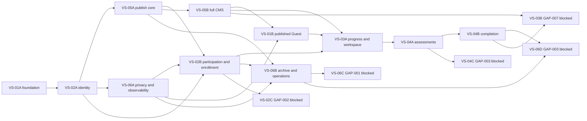

# DP-06 — Implementation Roadmap and Dependencies

| Metadata | Value |
|---|---|
| Version | v0.1.0 |
| Status | Draft — Not Approved |
| Approval gate | AG-06 — Not Approved |
| Purpose | Validate the provisional VS-01–VS-06 roadmap against approved contracts and actual dependencies. |

## 1. Authority, scope and limits

Sources: current [Decision Registry](../DP-01/03-decision-registry.md) and [Open Decisions Register](../DP-01/04-open-decisions-register.md); [DP-02 rules](../DP-02/02-domain-rules-and-invariants.md), [DP-03 modules](../DP-03/02-module-boundaries-and-dependencies.md) and [transactions](../DP-03/05-consistency-and-transaction-design.md), [DP-04 API](../DP-04/01-api-contract-and-resource-design.md), [security](../DP-04/02-authentication-authorization-and-security.md), [operations](../DP-04/04-infrastructure-and-deployment-operations.md), and [DP-05 gates](../DP-05/05-release-evidence-and-go-no-go-criteria.md). AG-05 is subsequently **Conditionally Approved** for the six DP-05 v0.1.0 documents; their original Draft metadata is historical. FA-004–008 B remain approved. This is a **proposed execution dependency plan**, not an implementation authorization, schedule or beta release decision. AG-06 is Not Approved; no VS slice may begin from this document alone.

GAP-001 (exceptional eligibility/revocation parameters and archived public listing), GAP-002 (Path leave/curriculum migration), GAP-003 (evidence compatibility/target eligibility and Attempt abandonment trigger), and GAP-007 (exact prerequisite-protected actions) remain **Open**. Their dependent work is blocked. No new product rule, Go provider, commercial SLA or numeric RPO/RTO is selected. Singapore remains a conditional region preference. Post-MVP recommendations, certificates, payments and automatic curriculum migration are excluded.

## 2. Dependency audit of the provisional sequence

| Original slice | Hidden dependency and correction |
|---|---|
| VS-01 Public Learning | A development-only Guest read can use immutable, versioned synthetic fixtures. A production-compatible Guest experience needs content authored, validated and published through the approved Admin path; direct fixture insertion is never a production publishing mechanism. Public visibility must filter drafts and answers. |
| VS-02 Identity/Participation | Identity/account lifecycle and Go ownership checks precede participation. Path join and Course enroll require published Path/Course versions and independent intent; browsing cannot create either. Deletion access restriction must be ready before real Student data is accepted. |
| VS-03 Progress/Evidence | Requires identity, Course pin, published versioned requiredness and Go-owned evidence tier. Workspace can share the Student foundation, but local Guest state cannot become official proof. |
| VS-04 Assessment/Completion | Requires versioned published assessment/policy, enrollment pin, atomic Attempt/Result data and evidence-tier checks. Base expiry/submission is separable from GAP-003 abandonment trigger; prerequisite-protected action coverage needs GAP-007. |
| VS-05 Admin CMS | A minimal trusted Admin bootstrap and versioned author/validate/preview/publish capability must precede production Guest content and version-sensitive learning. Full block/assessment authoring may follow that minimum. |
| VS-06 Lifecycle/Operations | Identity security, redaction, request correlation, deletion access restriction, durable cleanup and restore guard cannot wait until the last slice when earlier slices store real Student data. Normal archive is separable from GAP-001 exceptional revocation. GAP-002/003/007 branches stay blocked. |

No circular dependency is required: foundation precedes identity, identity precedes Admin bootstrap, Admin publication precedes production Guest reads and Student enrollment; the privacy prerequisite branches from identity and rejoins before Student data. The provisional order VS-01→VS-06 would defer both publishing and deletion safeguards too long.

## 3. Dependency-validated roadmap (proposal for AG-06)

`VS-xxA/B` are proposed smaller increments under the Product Owner's provisional VS labels, **not newly approved product features**. “Eligible for later authorization” means only that the approved policy boundary can be specified; every increment still requires AG-06 and explicit Product Owner slice authorization. The [backlog](03-vertical-slice-backlog-and-acceptance-contracts.md) owns acceptance detail.

| Order / ID | Increment and independently verifiable outcome | Must follow | Policy state |
|---|---|---|---|
| 1 VS-01A | Go/React/API foundation, versioned public read with disposable development fixtures; safe Guest demonstration only. | None; environment and contract setup. | Approved boundary, future authorization required. |
| 2 VS-02A | Verified Supabase identity, internal Account/role, own-object authorization, trusted Admin bootstrap and deletion access-state guard with synthetic accounts only until VS-06A. | VS-01A. | Approved boundary, future authorization required. |
| 3 VS-05A | Minimal Admin draft/validate/preview/publish for versioned Course/Path/Lesson content and audit. | VS-02A. | Approved boundary, future authorization required. |
| 4 VS-06A | Durable deletion lifecycle/owner cleanup/restore suppression plus baseline redacted observability and safe recovery; gate before real Student data. | VS-02A; owner interfaces from VS-01A/02A. | Approved FA-006/B1 and FA-008 boundary; future authorization required. |
| 5 VS-02B | Independent Path join and Course enrollment with latest eligible published pin; no implicit member enrollment. | VS-02A, VS-05A and versioned published content; VS-06A before any real Student data. | Approved core; GAP-002 leave excluded, GAP-007 exact action coverage excluded. |
| 6 VS-05B | Full MVP block/assessment policy authoring, preview and publication, preserving earlier pins. | VS-05A. May run parallel to VS-02B. | Approved core; no unsupported prerequisite type. |
| 7 VS-01B | Production-compatible public catalog, flagship Course details and every free Lesson from controlled published content. | VS-05B and VS-06A before real Admin publishing; verified published flagship content. | Approved boundary; archived listing detail GAP-001 excluded. |
| 8 VS-03A | Version-aware progress, server-tiered activity evidence and own notes/bookmarks/preferences. | VS-02B, VS-05B, VS-01B. | Approved core; no forged Guest passing. |
| 9 VS-04A | Version-locked Attempt start/resume, default expiry, retry accounting for approved terminal events, idempotent submit and immutable Go grade. | VS-03A, VS-05B. | Approved core; abandonment trigger GAP-003 excluded. |
| 10 VS-04B | Explicit Lesson/Course completion and globally reusable Course proof/Path progress from authoritative evidence. | VS-04A, VS-03A. | Approved core only where no unresolved GAP-007 action policy is required. |
| 11 VS-06B | Normal archive/unpublish, retained eligible pinned access, operational alerts, rollback and isolated restore drills. | VS-05A, VS-02B, VS-06A. | Approved core; exceptional revocation and archived listing detail excluded. |
| Blocked VS-02C | Path leave/curriculum-version migration. | VS-02B and Product Owner GAP-002 disposition. | **Blocked — GAP-002.** |
| Blocked VS-04C | Explicit Attempt abandonment trigger and associated retry transition. | VS-04A and Product Owner GAP-003 disposition. | **Blocked — GAP-003.** |
| Blocked VS-06C | Exceptional revocation and archived public listing policy. | VS-06B and Product Owner GAP-001 disposition. | **Blocked — GAP-001.** |
| Blocked VS-06D | Manual Course version migration with compatible evidence and target eligibility. | VS-04B, VS-06B and Product Owner GAP-003 disposition. | **Blocked — GAP-003.** |
| Blocked VS-03B | Exact protected-action prerequisite enforcement matrix. | VS-04B, VS-05B and Product Owner GAP-007 disposition. | **Blocked — GAP-007.** |

The order is a **dependency order**, not a promise of sequential staffing or dates. VS-05B and VS-02B can advance in parallel after their predecessors, using synthetic accounts until VS-06A; VS-06A must be verified before real Student/Admin data or production publishing, and VS-06B can advance alongside assessment work. A blocked branch stays absent from implementation until its named decision and contract update are approved. Early increments are not permission to release an incomplete MVP: committed prerequisite behavior and other required conditional scope must be resolved before a beta release decision if included in that release scope.

The graph is acyclic. Arrow means prerequisite, not automatically authorized execution. Each node must independently satisfy the [readiness gates](05-implementation-readiness-and-quality-gates.md). [Repository architecture](02-repository-architecture-and-engineering-standards.md), [delivery controls](04-secure-delivery-and-change-management.md) and [handoff register](06-execution-traceability-and-handoff-register.md) are related. No application or migration files are created by this roadmap.

## 4. Resource and independence audit

“Schema” identifies a future reviewed PostgreSQL migration need, **not an authored SQL migration**. “Storage” means a permitted managed object boundary, never browser service credentials. Basic redacted request/error observability begins with VS-01A and grows with each owner; no slice waits for a final operations dashboard before logging its own failures.

| Increment | Identity / published content / Admin dependency | Schema, Storage and worker need | Independence, observability and GAP boundary |
|---|---|---|---|
| VS-01A | No Student identity; versioned synthetic public snapshots; no Admin CMS dependency in disposable development. | Public content/projection schema; safe public fixture media if used; no worker. | Independently demoable in isolation; request/visibility logging; archived listing GAP-001 excluded. |
| VS-02A | Supabase identity and trusted Admin bootstrap; no published content required. | Account/role/access-state and audit schema; no private Storage or worker needed yet. | Synthetic-only until VS-06A; auth failure/audit observability; no GAP policy required. |
| VS-05A / VS-05B | Verified Admin; produce validated published Course/Path/Lesson/Block/Assessment versions. | Draft/version/policy schema; secured media Storage where needed; durable audit, with no automatic migration worker. | Can be developed with synthetic Admin; publish/error/audit signals; GAP-002/007 branches excluded. |
| VS-06A | Authenticated own deletion and restricted lifecycle; no published learning prerequisite. | Deletion case/ledger schema, private Storage/Auth cleanup, bounded durable worker and isolated restore capability. | Privacy prerequisite for real Student/Admin data; worker/deadline/restore alerts; no GAP-derived retention exception. |
| VS-01B | Public Guest read, but depends on trusted Admin publication and verified flagship versions. | Catalog/content schema and safe public media; no new worker required. | Public journey demoable after VS-05B/06A; visibility/error metrics; GAP-001 archived listing excluded. |
| VS-02B | Authenticated Student plus published Path/Course; Admin not in the Student command path. | Participation/enrollment/pin schema; no private Storage or worker needed for core join/enroll. | Can advance parallel to VS-05B with synthetic data; pin/owner/denial metrics; GAP-002/007 branches excluded. |
| VS-03A | Student identity, pinned published Lesson and versioned activity requiredness. | Evidence/progress/workspace schema; private objects only if a separately approved content class needs them; no core evidence worker. | Depends on VS-01B/02B/05B; evidence validation and BOLA telemetry; GAP-007 coverage excluded. |
| VS-04A / VS-04B | Student identity, pinned published Assessment/policy and verified activity evidence. | Attempt/Submission/Result/completion schema with uniqueness; optional bounded expiry work, but server time guards every command. | Atomic grade/completion observable by ID; GAP-003 abandonment and GAP-007 protected-action branches excluded. |
| VS-06B | Admin archive plus Student pinned access and prior privacy foundation. | Publication/access/audit schema; Storage access must honor publication; recovery jobs/drills where needed. | Can progress alongside assessment after VS-02B; alerts/rollback evidence; GAP-001 exception/listing excluded. |
| VS-02C / VS-04C / VS-06C / VS-06D / VS-03B | Each requires named approved GAP policy in addition to its core predecessor; Admin/Student roles vary by row in §3. | Any new schema/worker/storage need must be reviewed **after** policy disposition, not guessed now. | Not independently implementation-ready; GAP-002/003/001/003/007 respectively. |
