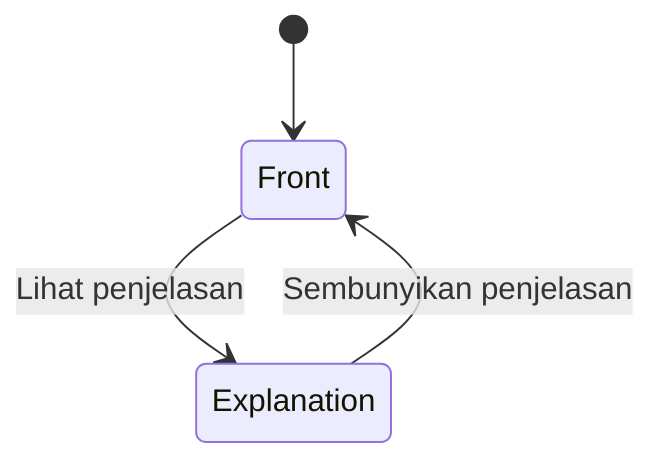

# AI Learning — Playful Neo-Brutalist Learning Experience

Laporan design discovery untuk `sipratama/ai-learning-platform` · 31 Oktober 2026, Asia/Jakarta.

**Hasil:** spesifikasi identitas dan lima layar Guest VS-01A yang orisinal, siap ditinjau sebelum implementasi. Dokumen ini tidak mengimplementasikan UI, mengubah kontrak backend, atau menyatakan fitur produk sudah tersedia. Tidak ada commit atau PR dibuat.

## Batas pekerjaan dan sumber kebenaran

Brief pengguna mengizinkan discovery/desain untuk Guest Catalog, Path Detail, Course Detail, Free Lesson Reader, dan flashcard lokal tanpa penilaian. Laporan memakai batas tersebut. Implementasi aplikasi tetap di luar pekerjaan ini.

Temuan repositori pada revisi `9b29797`:

- [README](../../README.md) dan [App React](../../apps/web/src/app/App.tsx) menunjukkan bootstrap dan halaman placeholder. API yang berjalan baru `/healthz`; API-001–005 serta layar produk belum tersedia.
- [Fixture aktual](../../apps/api/internal/devfixture/manifest.json) dan [public projections Go](../../apps/api/internal/devfixture/fixture.go) sudah tersedia secara internal. Datasetnya `vs01a-guest-proof@1.0.0`, snapshot publik `pub-v1`.
- [Kontrak teknis VS-01A, bagian 4](../DP-04/01-api-contract-and-resource-design.md) menentukan DTO publik, pencarian, filter keanggotaan, cursor, versi, dan lima tipe Block.
- [Kontrak fixture, bagian 5](../DP-06/03-vertical-slice-backlog-and-acceptance-contracts.md) menentukan bukti Guest yang dibatasi pada fixture pengembangan.
- [Decision Registry, bagian 16](../DP-01/03-decision-registry.md) mencatat AG-06 sebagai baseline perencanaan yang disetujui kondisional; implementasi fitur tetap membutuhkan otorisasi tersendiri. Beberapa paragraf historis DP-06 mengatakan fixture belum ada; kode fixture aktual dan README menunjukkan kondisi lebih baru. Laporan tidak mengubah dokumen sumber tersebut.

**Pemisahan penting:** data fixture tersedia secara internal; perilaku API tercantum dalam kontrak tetapi belum diimplementasikan; semua komposisi layar berikut adalah **DESIGN PROPOSAL**. Tidak ada klaim kesiapan beta atau hasil pengujian aplikasi.

**OUT OF SCOPE:** login/registrasi fungsional, profil Student, enrollment/partisipasi, progress Student, streak, sertifikat, achievements, kuis/assessment, grading, official completion, notes/bookmarks tersinkronisasi, AI tutor, rekomendasi personal, pembayaran, CMS, serta perilaku archive/revocation yang bergantung pada GAP terbuka. Jangan menampilkan kontrol fitur tersebut, termasuk tombol palsu atau menu terkunci yang menyiratkan implementasi.

## A. Reference observations dan confidence

### A1. Metode dan batas bukti

Referensi: [dashboard publik Ailene](https://www.ailene.id/dashboard). Halaman memberikan HTTP 200 dan dapat diamati tanpa autentikasi. Observasi dilakukan memakai Chrome headless dengan profil sementara, locale `id-ID`, dan preferensi reduced motion. Tidak digunakan cookie akun pengguna, akses privat, pemeriksaan bundle aplikasi, source map, endpoint privat, ataupun bypass autentikasi.

**Screenshot yang disebut disuplai pengguna tidak tersedia dalam pesan maupun berkas gambar repositori yang diperiksa.** Karena itu screenshot tersebut belum dapat dipakai sebagai referensi utama. Capture browser yang dibuat selama discovery adalah bukti pengganti sementara, bukan screenshot yang diklaim berasal dari pengguna. Perbandingan terhadap screenshot asli tetap **NOT VERIFIED**.

Label bukti:

| Label | Arti | Aturan confidence |
|---|---|---|
| **OD — Observed directly** | Terlihat pada render browser atau terjadi setelah interaksi normal; angka ukur berasal dari elemen yang sudah dirender. | Tinggi untuk keadaan dan viewport yang diuji, bukan untuk seluruh situs. |
| **IS — Inferred from screenshot** | Kesimpulan dari satu gambar statis tanpa pembuktian interaksi. | Sedang/rendah; tidak membuktikan perilaku. Tidak digunakan untuk screenshot pengguna karena berkasnya tidak tersedia. |
| **NV — NOT VERIFIED** | Tidak diobservasi, bukti tidak tersedia, atau percobaan belum menghasilkan keadaan yang dapat diperiksa. | Tidak ada klaim hasil. |
| **DP — Design proposal** | Keputusan orisinal untuk AI Learning pada bagian B–L. | Spesifikasi yang diusulkan, bukan pengukuran Ailene atau hasil implementasi. |

Capture yang diperiksa: desktop 1440×1000, tablet 834×1112, mobile 390×844, pada skala 1×. Tampilan awal memunculkan tur onboarding; tur ditutup melalui kontrol yang tersedia sebelum memeriksa layout utama. Capture full-page juga diperiksa untuk urutan bagian di bawah fold.

### A2. Anatomi visual

| Area | Observasi dan batasnya | Bukti / confidence |
|---|---|---|
| Sidebar desktop | Lebar terukur 248 px; tinggi mengikuti viewport. Logo dan pencarian di atas, navigasi berkelompok di tengah, status Guest di bawah. Label kelompok membentuk empat rumpun utama: belajar, pustaka, praktik, dan akses komersial. | OD / tinggi, 1440 px. |
| Kepadatan navigasi | Tautan utama sekitar 42 px tinggi, teks 14 px/600, ikon dalam bidang warna kecil, sela antartautan sekitar 2 px. Pemisahan kelompok lebih besar daripada sela item. | OD / tinggi, desktop. |
| Navigasi aktif | Item aktif memakai bidang gelap dan teks terang; penanda `aria-current="page"` teramati pada tautannya. Status aktif tidak hanya ditandai warna ikon. | OD / tinggi untuk item yang diperiksa. |
| Lebar area utama | Pada 1440 px, area utama berukuran 1120 px dan mulai sekitar x=284, menyisakan sekitar 36 px setelah sidebar. Ada whitespace nyata antara navigasi dan materi. | OD / tinggi, satu viewport. |
| Proporsi kolom | Bagian atas setelah layout menetap menempatkan blok utama sekitar 792 px dan rail pendamping sekitar 291 px, dengan gutter di antaranya; secara kasar 73:27 setelah gutter dikeluarkan. Bagian katalog berikutnya membentang lebih lebar. | OD / sedang: ukuran rail dipengaruhi keadaan layout/animasi; bukan aturan universal situs. |
| Pembagian hero | Kartu utama terbagi dua: panel visual sekitar 34% dan informasi/aksi sekitar 66%. Pada mobile panel visual berpindah ke atas informasi. | OD / tinggi pada capture yang diperiksa. |
| Header dan tipografi | Greeting menjadi H1 terbesar, dengan satu kata diberi bidang warna cerah. Ukuran H1 terukur 56 px di desktop, sekitar 41,7 px di tablet, dan 32 px di mobile; bobot 800. Badges dan deskripsi jauh lebih kecil. Nama keluarga font render teramati sebagai Stack Sans Headline; lisensi/berkas font tidak diteliti. | OD / tinggi untuk render; bukan rekomendasi menyalin font/komposisi tersebut. |
| Cards | Campuran kartu putih/netral dan panel warna; outline gelap, radius cukup besar, shadow keras mengarah kanan-bawah. Kartu hero terukur border 2 px, radius 24 px, shadow sekitar 6×7 px tanpa blur. Kartu pendukung lebih ringan daripada hero. | OD / tinggi untuk hero; sedang untuk generalisasi kartu lain. |
| Buttons | CTA dominan berbentuk pill dengan outline gelap dan shadow keras. Satu CTA terukur tinggi 54 px, border 2 px, shadow 4×4 px. Ikon arah membantu mengenali aksi navigasi. | OD / tinggi untuk sampel. |
| Hover | Hover pada CTA yang diperiksa menggeser elemen sekitar −2/−2 px dan membesarkan shadow menjadi 6×6 px. Item sidebar aktif yang di-hover tidak menunjukkan perubahan layout pada sampel tersebut. | OD / tinggi, input mouse dan reduced motion aktif. Tidak digeneralisasi ke seluruh kontrol. |
| Chips, selector, indicators | Ada badge status, selector tampilan dua pilihan, nomor urutan materi, progress berbentuk cincin dan segmen. Semantik keyboard selector serta akurasi progress tidak diuji. | OD / tinggi untuk keberadaan visual; NV untuk perilaku/otoritas data. |
| Ritme spacing | Ruang antarseksi lebih besar daripada padding internal kartu. Pada sampel desktop, main memiliki padding atas 72 px; di tablet/mobile 28 px. Gutter main mobile terukur 24 px. Kartu CTA memakai padding internal sekitar 26–28 px. | OD / tinggi untuk sampel; seluruh spacing scale situs NV. |
| Ikon dan ilustrasi | Ikon outline berujung membulat, ditempatkan dalam ubin warna. Ilustrasi karakter kecil dekat petunjuk/tur; banyak thumbnail berupa komposisi grafis mini, bukan foto. Ilustrasi mendukung orientasi dan karakter visual. | OD / tinggi untuk penempatan; IS / sedang untuk interpretasi tujuan dari capture browser. |
| Tablet | Pada lebar 834 px, sidebar desktop hilang, header ringkas tampil, dan navigasi menjadi dock bawah. Main menggunakan lebar viewport dikurangi gutter 24 px kiri/kanan. | OD / tinggi. Titik breakpoint persis NV. |
| Mobile | Pada lebar 390 px, hero menumpuk vertikal, rail pendamping menjadi baris-baris ringkas, beberapa kelompok materi dilipat, dan daftar kartu tertentu tetap memakai overflow horizontal. Dock bawah berisi lima tujuan/aksi. | OD / tinggi untuk capture mobile. |
| Overflow | `scrollWidth` dokumen sama dengan viewport pada 834 dan 390 px. Beberapa carousel memiliki overflow internal yang terlihat. Ini bukan audit semua halaman atau ukuran. | OD / tinggi untuk dua capture. |
| Onboarding | Overlay awal menampilkan karakter, penanda tahapan, tombol lanjut, opsi menunda/menutup. Focus ring jelas terlihat pada tombol utama di capture awal. Opsi menunda dapat menutup tur. | OD / tinggi. Focus trap dan seluruh tahapan tur NV. |
| Fokus keyboard | Menekan Tab menampilkan skip link menuju konten utama dengan outline solid sekitar 3 px. Programmatic focus pada tautan sidebar tidak cukup untuk menyimpulkan kualitas `:focus-visible`; jangan menganggapnya kegagalan aksesibilitas. | OD / tinggi untuk skip link; NV untuk audit keyboard penuh. |
| Navigasi nyata | Klik CTA materi membuka halaman Lesson publik; klik tautan alur membuka `/alur`. Kedua tujuan menampilkan heading yang sesuai jenis halaman, tanpa autentikasi. Persistensi dan seluruh cabang navigasi tidak diuji. | OD / tinggi untuk dua transisi. |
| Pencarian | Kontrol pencarian terlihat. Percobaan klik tidak menghasilkan input/dialog yang dapat diperiksa dalam waktu tunggu 10 detik, sehingga pencarian, hasil kosong, dan pengembalian fokus tidak berhasil diverifikasi. Ini bukan bukti fitur situs rusak. | OD untuk kontrol; NV untuk hasil dan interaksi lanjutannya. |
| Loading, empty, error | Tidak diperoleh keadaan loading yang stabil, hasil kosong yang valid, atau error aplikasi yang dapat diperiksa. Tidak ada fault injection atau akses URL privat. | NV. |
| Aksesibilitas keseluruhan | Landmark main/nav, beberapa nama aksesibel tombol, `aria-current`, dan skip link teramati. Kontras seluruh situs, screen reader, zoom, urutan fokus lengkap, reduced-motion compliance, dan target sentuh keseluruhan belum diaudit. | OD untuk sampel struktur; NV untuk kepatuhan menyeluruh. |

**Interpretasi dari screenshot:** entri IS di atas hanya interpretasi atas capture browser sendiri. Ukuran dan perilaku yang tercatat sebagai OD berasal dari browser, bukan dugaan dari gambar pengguna yang hilang.

### A3. Register bukti

Bukti kerja disimpan sementara di luar repositori, bukan sebagai aset AI Learning:

- [Capture desktop](</tmp/ai-learning-discovery/ailene-desktop-clean-1440.png>), [tablet](</tmp/ai-learning-discovery/ailene-tablet-clean-834.png>), dan [mobile](</tmp/ai-learning-discovery/ailene-mobile-clean-390.png>).
- [Metrik browser](</tmp/ai-learning-discovery/browser-evidence.json>), [pengukuran kartu dan keterbatasan pencarian](</tmp/ai-learning-discovery/interaction-evidence.json>), serta [hover, keyboard, dan navigasi](</tmp/ai-learning-discovery/navigation-evidence.json>).
- [REA Evidence](</tmp/ai-learning-discovery/rea-evidence.json>), ID `ev_acb54644a72bb69cb81ed5cac6423497da70741964702614b76d2ee2d66e647f`: satu skenario browser milik REA, viewport 1440×1000, membuka dashboard dan menunggu 3 detik, dengan capture URL/accessibility. Browser milik REA selesai dengan `terminated-owned-process`.

REA Evidence tersebut membuktikan skenario terbatas itu saja. Pengukuran CSS render, resize, hover, dan klik navigasi berasal dari observasi Playwright terpisah dan **tidak diklaim sebagai REA Evidence**. Berkas `/tmp` bersifat sementara; laporan ini memuat temuan penting agar tetap dapat dibaca tanpa capture tersebut. Identitas binary situs, alur akun, dan perilaku sebelum jendela observasi tidak diketahui.

## B. Pola terinspirasi Ailene yang layak diadopsi

Semua penerapan berikut **DP**, menggunakan prinsip umum, bukan rekonstruksi layout referensi.

| Prinsip yang dipetik | Adaptasi orisinal AI Learning |
|---|---|
| Kontras kuat membuat titik masuk mudah dikenali. | Forest sebagai tinta, Lime untuk aksi prioritas, canvas hangat untuk ruang baca. |
| Hard shadow memberi kesan objek yang dapat ditekan. | Shadow tetap 2/4/6 px, dipakai pada tombol dan kartu navigasi terpilih, tidak pada setiap paragraf. |
| Grouping membantu memindai banyak materi. | Dua jenis katalog jelas: Learning Path dan Course; kurikulum bertingkat di detail Course. |
| Badge kecil dapat menjelaskan konteks sebelum aksi. | Label Gratis dan Latihan lokal dengan kata yang eksplisit, tanpa simbol pencapaian. |
| Informasi pendamping dapat dipadatkan pada layar kecil. | Metadata berpindah ke baris inline; daftar isi Reader menjadi disclosure. |
| Visual sederhana dapat membuat materi terasa ramah. | Motif orisinal berupa lembar catatan dan penanda indeks geometris; dekorasi kecil, tanpa karakter maskot. |

## C. Pola yang tidak boleh disalin

- Nama, logo, maskot, ilustrasi, thumbnail, foto, teks materi, nama program, dan identitas komersial Ailene.
- Greeting yang sama beserta highlight kata dan tata letak hero, panel cincin, rail statistik, dan carousel yang disusun sebagai satu komposisi identik.
- Bentuk ilustrasi chat/karakter dan kumpulan ikon berwarna dengan penempatan serta rotasi yang sama. Gunakan satu sistem ikon outline berlisensi jelas atau SVG sederhana yang dibuat sendiri.
- Nilai warna, font, radius, shadow, CSS, kode komponen, atau struktur bundle hasil ekstraksi. Angka referensi pada bagian A adalah pengamatan, bukan token implementasi.
- Badge streak, medali, persentase pencapaian, progress selesai, akses terkunci, ajakan login, atau paywall referensi. Selain mengurangi orisinalitas, fitur itu melampaui VS-01A.
- Dashboard yang padat untuk dua Path dan dua Course. Hindari carousel dan panel statistik kosong yang dibuat untuk meniru skala konten produk lain.
- Tour yang menghalangi tugas pertama, konfeti, suara otomatis, dan dekorasi bergerak terus-menerus. Kelima layar ini dapat dipahami dari label dan hierarki tanpa onboarding modal.

## D. Prinsip identitas orisinal AI Learning

**Konsep: meja belajar dengan lembar catatan dan penanda indeks.** Katalog terasa seperti pilihan bahan belajar yang jelas; Reader terasa seperti halaman materi yang lapang. Ciri pengenal adalah outline Forest, sudut 8/12 px yang lebih tegas, aksen indeks geometris di tepi kartu, dan heading huruf kecil/besar normal tanpa highlight greeting personal.

1. **Belajar bisa dimulai langsung.** Aksi utama selalu membuka materi publik, tanpa gerbang akun.
2. **Playful membantu orientasi.** Warna membedakan jenis permukaan dan tingkat perhatian, bukan memberi skor pada pengguna.
3. **Data menentukan isi.** Judul, jumlah, urutan, dan akses berasal dari public projection; dekorasi tidak menciptakan metadata palsu.
4. **Katalog ekspresif, Reader tenang.** Batas dan shadow paling terasa pada keputusan navigasi. Materi panjang memakai bidang datar, panjang baris nyaman, dan jarak paragraf konsisten.
5. **Latihan lokal dijelaskan apa adanya.** Membuka flashcard tidak menghasilkan nilai, progress resmi, atau completion.
6. **Navigasi membawa konteks.** Breadcrumb, judul Course, dan daftar Lesson menjelaskan posisi tanpa cincin progress atau dashboard personal.

Voice UI memakai bahasa Indonesia yang langsung dan ramah. Usulan microcopy di bawah milik AI Learning; teks fixture tetap ditampilkan sesuai data, termasuk konten berbahasa Inggris. Jangan menerjemahkan atau mengganti materi fixture secara diam-diam.

## E. Design tokens

Semua nilai pada bagian ini **DP**, termasuk lima warna awal dari brief; bukan nilai warna Ailene yang diekstrak. Nilai px adalah acuan pada root 16 px; implementasi tipografi/spacing memakai rem agar mengikuti pengaturan pengguna.

### E1. Warna dan kontras

| Token | Nilai | Pemakaian |
|---|---|---|
| `color.canvas` | `#F7F7F1` | Latar aplikasi. |
| `color.surface` | `#FFFFFF` | Kartu, bidang baca, input. |
| `color.ink` / `color.border` | `#17382F` | Forest: teks utama, ikon, batas, shadow. |
| `color.action` | `#C9F45D` | Lime: aksi utama dan selected state. |
| `color.accent.warm` | `#FFB48F` | Peach: callout dan bidang flashcard. |
| `color.accent.cool` | `#A9DDF2` | Sky: konteks informasi/metadata. |
| `color.text.secondary` | `#4A6359` | Deskripsi dan metadata di atas canvas/putih. |
| `color.error` | `#9D2925` | Teks/ikon error di atas canvas/putih, selalu disertai pesan. |
| `color.focus` | `#17382F` | Outline fokus; gunakan pemisah putih pada komponen gelap. |

Rasio berikut dihitung dari sRGB menggunakan relative luminance WCAG, dibulatkan dua desimal; perhitungan warna bukan bukti seluruh komponen lolos audit.

| Foreground / background | Rasio | Aturan |
|---|---:|---|
| Forest / Canvas | 11,89:1 | Teks normal, heading, ikon, outline. |
| Forest / Putih | 12,78:1 | Teks normal dan bidang baca. |
| Forest / Lime | 10,09:1 | Teks tombol utama dan selected chip. |
| Forest / Peach | 7,41:1 | Callout dan flashcard. |
| Forest / Sky | 8,71:1 | Badge informasi. |
| Canvas / Forest | 11,89:1 | Navigasi aktif dan tombol gelap. |
| Putih / Forest | 12,78:1 | Alternatif teks pada bidang gelap. |
| Secondary / Canvas | 6,06:1 | Metadata biasa. |
| Secondary / Putih | 6,52:1 | Deskripsi kartu. |
| Error / Canvas | 7,03:1 | Pesan error. |

**Larangan pasangan:** putih di atas Lime/Peach/Sky hanya sekitar 1,27/1,72/1,47:1; jangan digunakan sebagai teks. Aksen terhadap canvas juga hanya sekitar 1,18–1,60:1 sehingga tidak cukup untuk menandai batas komponen sendirian: tambahkan outline Forest. Teks secondary hanya ditentukan untuk canvas/putih; gunakan Forest pada bidang aksen. Jangan mengurangi opacity teks atau border hingga pasangan berubah tanpa dihitung ulang.

Target minimum teks normal 4,5:1; teks besar 3:1; batas/indikator esensial 3:1 terhadap warna di sebelahnya. Rujukan: [WCAG 2.2](https://www.w3.org/TR/WCAG22/), khususnya 1.4.3 dan 1.4.11.

### E2. Tipografi

Usulan keluarga utama **Public Sans**, dengan fallback `ui-sans-serif, system-ui, sans-serif`; kode memakai `ui-monospace, SFMono-Regular, Consolas, monospace`. Gunakan hanya berkas font yang lisensinya telah diperiksa; self-host bila tersedia dan disetujui. Selama font belum disediakan, system font cukup untuk spesifikasi awal. Tidak mengambil berkas font referensi.

| Token | Desktop | Mobile | Weight / line-height |
|---|---:|---:|---|
| `type.display` | 48 px | 32 px | 750 / 1,12; intro Catalog saja. |
| `type.h1` | 36 px | 28 px | 750 / 1,2; judul detail/Reader. |
| `type.h2` | 28 px | 24 px | 700 / 1,25. |
| `type.h3` | 22 px | 20 px | 700 / 1,35. |
| `type.body` | 16 px | 16 px | 400 / 1,6. |
| `type.reading` | 18 px | 18 px | 400 / 1,7; paragraf Lesson. |
| `type.label` | 14 px | 14 px | 600 / 1,45. |
| `type.caption` | 13 px | 13 px | 500 / 1,5; informasi tambahan saja. |
| `type.code` | 15 px | 15 px | 400 / 1,65. |

Heading memakai tracking −0,02em maksimum; body normal. Heading dan judul kartu wrap secara alami. Hindari tinggi tetap dan truncation judul/aksi. Summary kartu boleh dibatasi secara visual hanya jika teks lengkap tersedia di detail; jangan menggantungkan akses teks pada tooltip hover. Reader dibatasi sekitar 65ch, tidak membentang penuh mengikuti desktop.

### E3. Spacing, border, radius, shadow

| Kategori | Tokens dan aturan |
|---|---|
| Spacing | `space.1=4`, `2=8`, `3=12`, `4=16`, `5=20`, `6=24`, `8=32`, `10=40`, `12=48`, `16=64` px. Skala dasar 4 px. |
| Component spacing | Ikon–label 8 px; antarfield 16 px; antarkartu 24 px desktop/tablet dan 16 px mobile; antarseksi 40/32 px. |
| Padding | Kartu 24 px desktop, 20 px tablet, 16 px mobile. Bidang baca 32/24/16 px. Tidak menumpuk kartu dalam kartu untuk setiap paragraf. |
| Border | `border.default=2px solid Forest`; `border.rule=1px solid Forest` untuk pemisah kurikulum; `border.emphasis=3px` khusus callout penting. |
| Radius | `radius.control=8px`; `radius.card=12px`; `radius.chip=999px`; `radius.code=8px`; tidak memakai radius 24 px hero referensi. |
| Shadow | `shadow.none=none`; `sm=2px 2px 0 Forest`; `md=4px 4px 0 Forest`; `lg=6px 6px 0 Forest`. Tanpa blur atau alpha. |
| Pemakaian shadow | Tombol dan kartu tujuan `sm/md`; intro Catalog maksimum `lg`; artikel Reader dan paragraf `none`. Sisakan gutter untuk shadow agar tidak terpotong. |
| Layer | Base 0, sticky header 20, backdrop 40, drawer/dialog 50, overlay fokus lokal tetap di atas bidang komponen. Tidak ada overlay fitur akun. |

### E4. Buttons, chips, cards, dan states

| Varian | Default | Hover / pressed | Batas penggunaan |
|---|---|---|---|
| Primary | Lime + Forest, border 2 px, shadow md. | Hover outline/underline label lebih jelas, shadow lg; pressed geser +2/+2 px dan shadow sm. | Satu prioritas utama per area tugas. Navigasi dibuat sebagai tautan yang ditata seperti tombol. |
| Secondary | Putih + Forest, border 2 px, shadow sm. | Hover canvas dan underline label; pressed shadow none. | Buka detail, kembali ke daftar, retry. |
| Dark | Forest + Canvas, border Forest. | Hover underline; pressed shadow none. | Pilihan alternatif untuk navigasi aktif, bukan semua CTA. |
| Text | Forest dengan underline, tanpa bidang/shadow. | Ketebalan underline naik; fokus tetap memakai ring. | Aksi tersier; tinggi area sentuh tetap memadai. |
| Icon | Bidang putih, ikon Forest 20 px, nama aksesibel. | Sama seperti secondary. | Hanya untuk menu/tutup; label teks lebih disukai bila ruang cukup. |
| Disabled | Canvas + secondary, border Forest, tanpa shadow. | Tidak bergerak; state disabled native. | Alasan terlihat di dekat kontrol; teks tetap terbaca. Jangan membuat fitur OUT OF SCOPE terlihat sebagai tombol disabled. |
| Pending | Label proses stabil dan indikator sederhana. | Cegah pengiriman ganda; status diumumkan. | Lebar tombol tidak berubah; fokus tidak dipindahkan. |

Ukuran tombol normal minimum tinggi 44 px, horizontal padding 16 px, gap 8 px; CTA utama 48 px. Tautan in-line tetap dikenali dengan underline. Kontrol bukan teks in-line menargetkan area sentuh minimum 44×44 px.

**Card variants:** `PathCard` canvas/putih dengan pita indeks Sky kecil; `CourseCard` putih dengan penanda geometris Lime; `IntroPanel` canvas dengan aksen Lime terbatas; `ReadingSurface` putih, outline ringan, tanpa shadow; `InfoCallout` Sky; `PracticeCard` Peach; `ErrorPanel` canvas dengan ikon dan teks Error serta batas Forest. Jangan memakai warna aksen untuk menyatakan tingkat kesulitan yang tidak tersedia di data.

**Badge/chip variants:** Gratis (Lime/Forest, sumber `isFree` atau hitungan Lesson gratis), Latihan lokal (Peach/Forest), tipe konten (Sky/Forest), metadata netral (canvas/Forest), selected filter (Lime/Forest + tanda pilih/teks), error (canvas + teks/ikon Error). Badge pasif bukan tombol dan tidak masuk urutan Tab. Chip filter aktif memiliki label hapus yang jelas; chip jumlah bukan skor.

**Focus:** `:focus-visible` outline Forest 3 px dengan offset 3 px; pada bidang Forest tambahkan pemisah putih 2 px sebelum outline Forest. Fokus terlihat pada semua latar, tidak terpotong overflow, dan tidak tertutup sticky header. Fokus dan active state memakai bentuk/underline/label tambahan selain warna.

**Cards interaktif:** judul adalah tautan utama yang jelas. Hindari nested button di dalam tautan seluruh kartu. Bila area klik diperluas, tetap satu tab stop per tujuan utama; tombol sekunder harus terpisah secara semantik dan visual.

### E5. Motion

- Transisi warna/border 120 ms; perubahan shadow 120 ms; disclosure/drawer maksimum 180 ms ease-out, tanpa bounce.
- Tidak menggerakkan layout halaman saat hover. Transform pressed dibatasi pada kontrol itu sendiri; hover card tidak dirotasi.
- Flashcard menggunakan reveal konten, bukan putaran 3D. Loading skeleton statis, tanpa shimmer.
- `prefers-reduced-motion: reduce` meniadakan transform/transisi dan smooth scroll; perubahan state tetap langsung terlihat. Tidak ada autoplay, konfeti, atau suara.

## F. Component inventory dan kontrak data

| Komponen | Isi / sumber | Interaksi dan state utama |
|---|---|---|
| `PublicShell` | Wordmark teks AI Learning; link Katalog; label konteks Guest. Tidak membutuhkan identity API. | Skip link, main landmark, layout responsif. |
| `CatalogTypeNav` | Dua tujuan: Learning Path dan Course. | Tautan URL berpenampilan segmented control, `aria-current`; bukan ARIA tabs jika mengubah URL. |
| `CatalogSearch` | `q` pada API-001/002; judul/summary saja. | Label terlihat, submit eksplisit, clear, validasi, loading, hasil kosong. |
| `MembershipFilter` | `courseId` untuk daftar Path; `pathId` untuk daftar Course. | Native select berlabel, hanya opsi publik yang telah diperoleh; pilihan opsional. Tidak ada filter level/harga/durasi. |
| `PathCard` | `title`, `summary`, `courseCount` dari PathSummary. | Tautan detail; tanpa progress/thumbnail wajib. |
| `CourseCard` | `title`, `summary`, `freeLessonCount` dari CourseSummary. | Tautan detail; label hitungan Lesson gratis, bukan seluruh durasi Course. |
| `CursorPager` | `page.nextCursor` dari endpoint aktif. | Tombol Muat lagi, pending, error append, retry. Hilang jika cursor null. |
| `Breadcrumbs` | Hierarki URL dan judul public detail yang sudah dimuat. | Nav berlabel; halaman sekarang bukan tautan aktif menuju dirinya sendiri. |
| `DetailHeader` | Title/description yang tersedia; counts yang sah. | Wrap judul panjang; CTA hanya jika tujuan publik benar-benar diketahui. |
| `OrderedCourseList` | `PathDetail.courses` sesuai urutan membership publik. | Angka adalah urutan, bukan rank/pencapaian. |
| `Curriculum` | `CourseDetail.modules[].lessons[]`. | Disclosure Module, daftar Lesson berupa tautan, penanda Lesson saat ini. |
| `LessonOutline` | CourseDetail untuk konteks LessonDetail. | Desktop nav; mobile disclosure berlabel Daftar lesson. |
| `BlockRenderer` | Hanya `richText`, `code`, `callout`, `flashcard`, `media`. | Berurutan menurut `position`; state error per Block untuk kegagalan rendering/media. |
| `FlashcardReveal` | `payload.front`, `payload.back`. | Reveal/hide lokal, label state, tanpa scoring atau server writes. |
| `StatusPanel` | UI copy dan detail error yang telah disaring. | Loading, empty, not found, retry; request ID hanya jika tersedia dan aman. |
| `MobileMenu` | Tujuan publik yang sama dengan shell desktop. | Dialog/drawer, Escape, focus trap, return focus, scroll lock. |

**Pemetaan data yang harus dipertahankan:**

| Layar | Sumber kontrak | Data fixture yang benar-benar tersedia |
|---|---|---|
| Guest Catalog | API-001 Paths dan API-002 Courses. | Dua Path publik, dua Course publik. Jangan menggabungkan jumlah hasil dari halaman parsial menjadi total global. |
| Path Detail | API-003. | Foundations Path berisi satu Course; Practice Path berisi dua Course. Course flagship memiliki canonical ID yang sama di kedua Path. |
| Course Detail | API-004. | Menguasai ChatGPT dari Nol: satu Module, dua Lesson gratis. Focused Practice: satu Module, satu Lesson gratis. |
| Free Lesson Reader | API-005; API-004 untuk judul Course/Module dan navigasi saudara. | First Steps: rich text, kode, flashcard, media; Safe Practice: callout; Focus Lesson: rich text. |
| Flashcard lokal | PublicBlock `flashcard` di LessonDetail. | Satu kartu pada First Steps; sisi belakang merupakan konten publik yang memang diizinkan. |

Public DTO **tidak** menyediakan thumbnail katalog, durasi, level, rating, jumlah peserta, instructor, learning outcomes terstruktur, kategori topik, prerequisite pribadi, enrollment availability, maupun field `flagship`. Jangan membuat komponen bergantung pada field tersebut. Flagship adalah fakta fixture yang diketahui dari sumber internal, tetapi bukan alasan untuk menambahkan badge `flagship` yang mengasumsikan field baru dalam public projection.

Media Lesson hanya berasal dari `payload.src` yang diperbolehkan, dengan `alt` dari payload. Motif kartu berupa dekorasi geometris orisinal bisa dibuat dari CSS/SVG sendiri dan diberi `aria-hidden`; motif itu tidak boleh terlihat sebagai screenshot atau ilustrasi isi Course yang sebenarnya tidak tersedia.

## G. Screen-by-screen layout specifications

### G1. Guest Catalog

**Tugas:** menemukan Path atau Course publik dan membuka detail. Mode utama Operate dengan intro singkat; tidak ada greeting personal atau panel statistik.

**Hierarki dan regions:** shell → H1 katalog → satu kalimat penjelas Guest → pilihan jenis katalog → form pencarian/filter → daftar hasil → Muat lagi jika tersedia. Pada layar lebar, intro berupa baris editorial sederhana; grid kartu memenuhi area konten. Tidak ada rail rekomendasi.

**Komponen:** PublicShell, CatalogTypeNav, CatalogSearch, MembershipFilter, PathCard/CourseCard, active-filter chips, status hasil, CursorPager. Judul/summary fixture tampil apa adanya. Counts pada kartu berasal dari DTO; jangan menampilkan total hasil pencarian jika endpoint tidak mengembalikannya.

**Navigasi dan URL:** usulan frontend `/catalog?type=paths` dan `/catalog?type=courses`, bukan perubahan endpoint API. `type` adalah state UI dan tidak dikirim sebagai query API. `q` dan filter keanggotaan sesuai endpoint aktif. Search dikirim lewat tombol Cari/Enter; query kosong menghapus `q`, bukan mengirim string kosong yang melanggar kontrak. `q` maksimal 100 code point setelah trim. Pergantian tipe mempertahankan `q` tetapi membersihkan filter yang tidak kompatibel dan cursor. Perubahan pencarian/filter membuat URL history entry; pengetikan sebelum submit tidak mengirim request. Back/Forward memulihkan tipe, filter, dan query.

Filter memakai opsi publik yang sudah dimuat dari endpoint pasangan; gunakan native select bila opsi sedikit. Jangan mengasumsikan satu halaman berisi semua opsi. Dengan fixture aktual dua opsi selesai dalam satu respons default; pada data lebih besar ikuti cursor pasangan atau sembunyikan filter sampai daftar opsi lengkap. Tidak memerlukan endpoint opsi tambahan.

**Mobile:** form satu kolom; pencarian penuh lebar, filter di bawahnya; dua pilihan tipe tetap berlabel teks. Kartu satu kolom, summary wrap; tanpa carousel. Primary CTA pada kartu tetap mudah disentuh tanpa menghilangkan judul.

**Loading:** shell, heading, dan form tetap terlihat; grid skeleton statis. Region hasil `aria-busy`. Saat mengganti filter, hasil lama tidak boleh tampil seolah cocok dengan query baru; tampilkan placeholder sampai respons sesuai request terbaru. Abaikan respons lama yang datang terlambat. Loading Muat lagi mempertahankan daftar yang sudah ada.

**Empty:** bedakan katalog aktif kosong dari hasil filter nol. Copy usulan: “Belum ada materi yang tersedia” atau “Belum ada hasil yang cocok”; keadaan kedua menawarkan Hapus filter. Jangan mengarahkan ke daftar/login atau mengisi kartu fiktif.

**Error:** initial read gagal menampilkan pesan ringkas dan Coba lagi. Error append tampil setelah kartu terakhir dengan retry cursor yang sama, tanpa menghapus hasil lama. Query/cursor invalid 400 memberi opsi reset daftar dengan query/filter valid dan tanpa cursor. 429 meminta mencoba lagi, tanpa timer palsu; 500 memberi retry. Request ID ditampilkan hanya bila aman dari respons. Hidden filter yang valid tetapi tak cocok tetap tampak sebagai daftar kosong, bukan pembocoran identitas.

**Aksesibilitas:** H1 tunggal; form label terlihat; hasil berupa list; pengumuman hasil/loading sopan via satu live region; perubahan filter tidak memindahkan fokus. Setelah append, fokus tetap pada tombol; konten baru dapat dicapai dengan urutan Tab wajar. Search scope disebutkan sebagai judul/ringkasan, bukan pencarian seluruh isi Lesson.

### G2. Path Detail

**Tugas:** memahami susunan Course pada suatu Path dan memilih Course. Membuka Path tidak melakukan join/enrollment.

**Hierarki dan regions:** breadcrumb Katalog → title + description Path → `courseCount` → daftar Course berurutan → tautan kembali ke katalog Path. Pada desktop, header memakai layout 8:4: judul/deskripsi lebih besar di kiri, panel metadata ringkas di kanan; daftar Course di bawah memakai lebar penuh. Panel metadata bukan area progress.

**Komponen:** Breadcrumbs, DetailHeader, badge jenis Path, count Course, OrderedCourseList. Setiap baris menampilkan nomor membership, title/summary, hitungan Lesson gratis yang tersedia pada CourseSummary, dan tautan Buka course. Tidak menambahkan outcomes atau estimasi waktu yang tidak ada.

**Mobile:** header bertumpuk, metadata di bawah deskripsi, daftar Course satu kolom, nomor urutan kecil di samping judul. CTA tidak terpotong bila judul dua hingga empat baris.

**Navigasi:** usulan frontend `/paths/:pathId`; API-003 tanpa query. Course memakai URL canonical `/courses/:courseId`; konteks Path boleh disimpan dalam history state lokal hanya jika berasal dari Path publik yang baru dikunjungi. Back ke Path mempertahankan asal; direct deep link Course tidak mengada-adakan Path. Course reuse tidak membuat identitas atau salinan baru.

**Loading:** breadcrumb umum tetap ada; placeholder judul dan list. Jangan menampilkan nama resource dari parameter URL atau state yang belum tervalidasi.

**Empty:** jika respons valid memiliki `courses: []`, tampilkan deskripsi Path dan “Course pada path ini belum tersedia”; hanya tombol kembali ke katalog, tanpa CTA mulai yang mati.

**Error:** 404 menggunakan “Materi tidak tersedia” untuk absent/hidden tanpa mengungkap sebab privat. 400 memberi kembali ke katalog; kegagalan sementara memberi retry. Tidak menebak nama Path, akses akun, atau versi draft.

**Aksesibilitas:** breadcrumb sebagai nav berlabel; daftar Course menggunakan ordered list; angka tidak diumumkan ganda oleh elemen dekorasi. Link tujuan memiliki nama yang menyertakan title Course. Perubahan route memberi document title baru, fokus ke H1/main setelah konten siap, dan tidak terhalang sticky header.

### G3. Course Detail

**Tugas:** memahami struktur Module/Lesson dan membuka Lesson gratis.

**Hierarki dan regions:** breadcrumb → title/description Course → hitungan Lesson gratis → CTA Baca lesson pertama jika ada → kurikulum Module → semua Lesson publik. Desktop menggunakan dua kolom 8:4 pada area isi: kurikulum kiri, panel akses gratis/aksi kanan. Title/description membentang di atas. Panel kanan opsional sticky di desktop jika seluruh isinya muat di viewport, dengan clearance dari header.

**Komponen:** DetailHeader, Course metadata, Curriculum, Module disclosure, Lesson links, informasi “Materi gratis dapat dibaca tanpa akun”. Tidak ada persentase progress, checkmark selesai, tombol enrollment, atau prerequisite gate.

**Sumber counts:** `freeLessonCount` adalah jumlah Lesson gratis yang diberikan API; jumlah Module dan urutan Lesson dapat dihitung dari CourseDetail. Jangan memakai `freeLessonCount` sebagai denominator completion. Jangan menyatakan Course fokus adalah flagship atau menampilkan label personal.

**Mobile:** panel aksi dipindah di bawah header sebelum kurikulum; tidak menjadi sticky bottom bar. Module pertama terbuka secara default; Module lain dapat memakai disclosure. Semua Lesson tetap bisa dijangkau dengan keyboard. Jika target deep link berada dalam Module tertutup, buka Module itu sebelum menempatkan fokus.

**Navigasi:** URL `/courses/:courseId`; API-004 tanpa query. CTA memilih Lesson gratis pertama dari urutan Module.position lalu Lesson.position. Tautan Lesson menuju `/courses/:courseId/lessons/:lessonId`. Baca tidak membuat enrollment. Semua Lesson flagship fixture tetap tersedia untuk Guest.

**Loading:** skeleton judul, metadata, kurikulum; CTA belum muncul sampai target publik diketahui. Tidak menggunakan Lesson placeholder yang bisa diklik.

**Empty:** jika Module atau Lesson kosong, tampilkan “Lesson belum tersedia” dan kembali ke katalog; jika Module tertentu kosong, jelaskan di Module tersebut dan tetap tampilkan Module lain. CTA pertama hanya ada bila tujuan valid tersedia.

**Error:** 404 generik; retry untuk kegagalan sementara. Respons tidak konsisten/DTO tidak valid menampilkan error data aman, tidak merakit kurikulum dari draft atau snapshot lain. Tidak ada ajakan login untuk memperbaiki error fixture publik.

**Aksesibilitas:** heading Module H2/H3 teratur; native disclosure atau button dengan `aria-expanded` dan `aria-controls`; tautan Lesson terpisah dari tombol disclosure. Status Gratis berupa teks. Nomor urutan tanpa ikon gembok. Fokus route dan document title sesuai Course.

### G4. Free Lesson Reader

**Tugas:** membaca konten dan mencoba Block yang tersedia tanpa akun. Mode Read; ekspresi visual dikurangi.

**Hierarki dan regions:** breadcrumb → nama Course/Module → H1 Lesson + badge Gratis → artikel Block → navigasi Lesson sebelumnya/berikutnya → kembali ke Course. Desktop memakai outline Lesson sekitar 256 px di kiri dan kolom baca fleksibel maksimal 65ch di kanan. Tidak ada sidebar global tambahan yang menghabiskan lebar untuk menu personal.

**Komponen:** ReaderShell, Breadcrumbs, LessonOutline, ReadingSurface, BlockRenderer, callout, media, code display, FlashcardReveal, PrevNextLinks. Metadata “Lesson 1 dari 2” boleh diturunkan dari urutan kurikulum yang sudah dimuat dan harus jelas berarti posisi materi, bukan progress. Tidak ada progress bar baca atau tandai selesai.

**Block behavior:**

- `richText`: render subset Markdown aman; heading isi dipetakan di bawah H1 halaman agar outline semantik konsisten. Raw HTML tidak dieksekusi; links hanya skema aman. Jangan memakai raw `innerHTML` yang belum disanitasi.
- `code`: teks literal dalam pre/code, termasuk teks yang menyerupai script; tidak ada tombol Jalankan atau sandbox. Wrap opsional pada teks biasa; baris kode panjang boleh scroll di region lokal yang memiliki label aksesibel.
- `callout`: teks biasa dengan ikon informasi dan label konteks bila diperlukan; tidak mengartikan semua callout sebagai warning.
- `media`: gambar publik dari path fixture yang diizinkan dan alt dari payload; lebar maksimal 100%, tinggi tidak dipaksa, tidak dipakai sebagai background. Jangan menebak dimensi konten sebagai metadata API baru.
- `flashcard`: reveal lokal sesuai G5; tidak ada assessment, skor, timer, atau submit jawaban.

**Konteks data:** API-005 menyediakan isi Lesson; API-004 menyediakan title Course, Module, dan sibling links. Keduanya harus konsisten dengan `courseId`, `courseVersionId`/`versionId`, dan snapshot. Jika permintaan konteks gagal sementara tetapi isi Lesson valid, artikel tetap dapat dibaca dengan tautan generik kembali ke Course; outline/PrevNext menampilkan retry lokal. Jika versi tidak cocok, jangan menggabungkan isi dan navigasi dari generasi berbeda; tampilkan status aman dan muat ulang konteks yang konsisten.

**Mobile/tablet:** outline berubah menjadi disclosure Daftar lesson di atas artikel, bukan overlay yang terus menutupi bacaan. Pada mobile judul Course/breadcrumb wrap; body 18 px, padding 16 px, tombol navigasi akhir bertumpuk. Outline tidak sticky pada viewport sempit. Tidak ada dock lima fitur atau banner login.

**Navigasi:** route `/courses/:courseId/lessons/:lessonId`. Prev/Next berasal dari flatten kurikulum publik dalam urutan Module lalu Lesson; posisi Lesson dapat mulai lagi dari 1 di Module baru. Transisi tidak mencatat completion. Pada Lesson terakhir, tampilkan “Kembali ke course”, tanpa ucapan lulus/selesai resmi. Deep link harus dapat dibuka langsung. Fresh navigation fokus ke judul; Back/Forward memulihkan posisi scroll lokal bila tersedia dan tidak memaksa kembali ke atas. Tidak menjanjikan penyimpanan lintas reload/perangkat.

**Loading:** title/article placeholders statis; nav publik yang telah valid boleh tetap ada. Jangan merender isi Lesson lama di bawah URL Lesson baru tanpa penanda pemuatan. Tidak memakai shimmer atau perpindahan tinggi berulang.

**Empty:** `blocks: []` yang valid menampilkan judul dan “Isi lesson belum tersedia”, kembali ke Course. Semua konten kosong tidak boleh tampak sebagai halaman putih tanpa penjelasan.

**Error:** 404 untuk absent/hidden/nonfree/mismatch memakai pesan generik yang sama. 400 memberi navigasi aman kembali ke Course/katalog. Error gambar menampilkan fallback berisi alt dan Coba muat gambar lagi, tanpa mengganti dengan aset eksternal. Error Block tertentu tidak menghilangkan Block lain; gunakan pesan aman, tanpa payload mentah. Pada unknown Block yang tidak sesuai kontrak, fail closed untuk Block itu; jangan mencoba render arbitrer.

**Aksesibilitas:** article dan nav landmark berlabel, urutan heading benar, skip link, alt media, kode teks dapat dipilih, links eksternal jelas bila membuka tab baru. Teks Inggris fixture dapat diberi `lang="en"` pada bagian yang diketahui; jangan menebak bahasa semua konten secara otomatis. Navigasi Lesson aktif memakai `aria-current="page"`; fokus terlihat; zoom dan text-spacing override tidak memotong isi.

### G5. Local ungraded flashcard interaction

**Tugas:** mempertimbangkan prompt di sisi depan, lalu membuka penjelasan yang ditulis author. Ini satu region tertanam dalam Lesson, bukan produk kuis atau deck terpisah.

**Hierarki dan regions:** label Latihan lokal → front → tombol Lihat penjelasan → back saat dibuka → satu kalimat batas lokal. Usulan copy: “Latihan ini tidak menghasilkan nilai atau kelulusan resmi.” Jangan memakai label benar/salah atau skor.

**Komponen dan visual:** PracticeCard Peach, teks Forest, outline 2 px, radius 12 px, shadow sm; dekorasi indeks kecil orisinal. Front tetap terlihat saat back dibuka. Tombol toggle adalah kontrol terpisah, bukan seluruh bidang kartu sebagai elemen klik tanpa semantik.

**State machine:**

State disimpan dalam memori komponen dengan identitas Course/version/Lesson/Block. Berpindah ke Lesson lain atau reload mengembalikan front. Tidak menulis localStorage, tidak mengirim evidence, tidak memanggil endpoint write, dan tidak mengubah data fixture. Memperlihatkan back yang publik tidak sama dengan membuka answer key assessment privat.

**Mobile:** full width bidang baca, tinggi otomatis, front/back wrap penuh. Tidak ada fixed height, flipping 3D, gesture swipe wajib, atau drag. Tombol minimal 44 px tinggi.

**Navigasi dan keyboard:** Enter/Space mengaktifkan tombol native. `aria-expanded` menunjuk region back via `aria-controls`; konten tersembunyi tidak ada di accessibility tree. Label tombol berubah menjadi Sembunyikan penjelasan. Fokus tetap di tombol dan state expanded diumumkan; screen reader dapat membaca region back sesudahnya. Tidak menambahkan live region yang membacakan seluruh materi dua kali.

**Loading:** kartu tidak membutuhkan request sendiri; mengikuti loading Lesson. Jangan menampilkan jawaban placeholder.

**Empty:** Lesson tanpa Block flashcard tidak menampilkan region flashcard kosong. Bila payload flashcard tidak lengkap, tampilkan pesan bahwa latihan ini belum tersedia; jangan membuat front/back sendiri.

**Error:** kesalahan payload/render hanya mengganti kartu itu dengan fallback; materi lain tetap terbaca. Tidak ada error jaringan setelah toggle karena reveal lokal. Reload Lesson tersedia lewat mekanisme error Reader bila data Lesson sendiri gagal.

**Aksesibilitas:** tidak ada warna sebagai satu-satunya pembeda front/back; keduanya memiliki label teks. Konten bukan input penilaian. Reduced motion memakai reveal langsung dan area bertambah mengikuti isi tanpa animasi putar.

## H. Responsive rules desktop/tablet/mobile

Breakpoint berikut adalah **DP orisinal**, bukan breakpoint Ailene yang diukur.

| Rentang | Shell dan gutters | Catalog / detail | Reader |
|---|---|---|---|
| Mobile: 320–767 px | Header 64 px sebagai min-height, boleh tumbuh; gutter 16 px. Menu berlabel membuka drawer; tanpa bottom dock. | Satu kolom; controls vertikal; metadata di bawah heading; gap 16 px. | Satu kolom, disclosure outline, padding artikel 16 px, body 18 px. |
| Tablet: 768–1199 px | Header ringkas, gutter 24 px, menu drawer. | Dua kolom kartu bila tiap kartu memiliki ≥280 px; detail tetap satu kolom sampai area cukup lebar. | Satu kolom terpusat maksimal 65ch; outline disclosure; padding 24 px. |
| Desktop: ≥1200 px | Sidebar 232 px, gutter konten 32 px; main maksimum 1200 px. Sidebar hanya berisi identitas dan tujuan publik nyata; jangan mengisi ruang dengan fitur semu. | Grid kartu 2 kolom; naik 3 hanya bila lebar area kartu mencapai ≥1032 px (3×328 + 2×24). Header detail 8:4; kurikulum/akses Course 8:4. | Outline 256 px + gap 32 px + artikel fleksibel maksimal 65ch. Bila ruang tidak cukup, kembali ke disclosure. |
| Lebar sangat besar | Ruang sisa menjadi margin; font/kolom tidak terus membesar. | Jangan meregangkan dua kartu fixture agar terkesan katalog besar. | Panjang baris tetap dibatasi. |

Aturan grid dihitung dari **lebar area konten**, bukan viewport saja. Contoh: viewport 1280 px dikurangi sidebar 232 px dan gutter 64 px menyisakan 984 px, sehingga memakai dua kolom. Pada viewport 1440 px, area 1144 px dapat memakai tiga track; fixture yang hanya memiliki dua kartu tetap menampilkan dua item tanpa kartu pengisi. Gunakan container-aware layout atau CSS grid yang memenuhi batas minimum di atas.

**Navigasi mobile:** tombol Menu selalu memiliki label aksesibel dan area 44×44 px. Drawer memuat Katalog serta dua jenis katalog yang benar-benar tersedia; konteks Course memakai disclosure Reader tersendiri. Dialog memiliki heading, tombol Tutup, focus trap, inert background, Escape, focus return ke pemicu, dan pencegahan scroll background. Pilihan route menutup drawer lalu memindahkan fokus ke konten tujuan. Tidak menampilkan login, achievement, resume personal, atau tujuan kosong.

Breadcrumb panjang wrap; pada mobile boleh diringkas menjadi tautan induk dan judul saat ini, dengan hierarki penuh tetap tersedia dari navigasi. Tidak menyembunyikan satu-satunya jalan kembali. Sticky desktop outline dibatasi tinggi viewport dan scroll sendiri; heading/anchor menggunakan scroll margin untuk clearance header.

Reflow harus berfungsi pada 320 CSS px dan zoom 400% dari viewport desktop 1280 px. Dokumen tidak memiliki horizontal scrollbar; pengecualian scroll lokal hanya untuk konten yang memang membutuhkannya, seperti kode. Ukuran teks tidak dikunci memakai viewport unit saja. Orientasi landscape serta safe-area inset pada drawer tetap diperhitungkan.

## I. Accessibility checklist

Target mengikuti FA-007: **WCAG 2.2 AA** pada journey kritis. Checklist adalah acceptance yang akan diverifikasi ketika UI diimplementasikan, bukan klaim lulus sekarang. Standar resmi: [WCAG 2.2](https://www.w3.org/TR/WCAG22/) dan panduan [WAI-ARIA Dialog Pattern](https://www.w3.org/WAI/ARIA/apg/patterns/dialog-modal/).

- [ ] Satu H1 per layar, heading berurutan, main/nav/article memiliki nama dan landmark yang sesuai; skip link bekerja.
- [ ] Teks normal ≥4,5:1; teks besar dan indikator/batas esensial ≥3:1. Seluruh state hover/focus/selected/error diperiksa, bukan default saja.
- [ ] Semua fungsi memakai keyboard; tidak ada target yang hanya tersedia saat hover atau memerlukan drag/swipe.
- [ ] Focus ring terlihat, urutan fokus masuk akal, dan fokus tidak tertutup sticky header/drawer; route dan Back/Forward menangani fokus secara berbeda sesuai konteks.
- [ ] Menu dialog mempunyai focus trap, Escape, inert background, tombol tutup, dan return focus; navigasi biasa menggunakan tautan, aksi menggunakan tombol.
- [ ] Target kontrol didesain 44×44 px minimum; ini target desain yang lebih besar daripada ketentuan minimum WCAG 2.2 AA 24×24 px dengan pengecualiannya. Link teks inline dinilai sesuai konteks/pengecualian.
- [ ] Status aktif/Gratis/error/reveal tidak hanya bergantung pada warna; icon-only memiliki nama aksesibel.
- [ ] Form punya label terlihat, instruksi batas query, dan error yang terhubung field; placeholder tidak menjadi label.
- [ ] Loading/hasil/error penting diumumkan secara proporsional; `aria-busy` tidak menyembunyikan jalur retry; tidak ada live announcement berulang untuk setiap skeleton.
- [ ] Reflow 320 CSS px, pembesaran teks 200%, zoom 400%, text-spacing override, dan judul sangat panjang tidak memotong fungsi/isi.
- [ ] Media memakai alt yang sah, dekorasi `aria-hidden`, kode tetap literal dan dapat dibaca, dan warna tidak menggantikan informasi.
- [ ] `prefers-reduced-motion` meniadakan gerak; tidak ada autoplay audio, flashing, atau animasi wajib.
- [ ] Flashcard collapsed/expanded terbaca dengan screen reader dan tidak menyiratkan grading/completion.
- [ ] Bahasa halaman `id`; bagian bahasa berbeda diberi penanda bila diketahui dari konten; fokus dan pembacaan diuji dengan VoiceOver/Safari dan satu pasangan browser/screen reader lain yang tersedia.

## J. Visual acceptance criteria

Kriteria ini menentukan hasil implementasi nanti. Semua berstatus **belum diuji pada AI Learning** karena pekerjaan ini hanya laporan.

| ID | Kriteria dapat diperiksa | Bukti yang diperlukan nanti |
|---|---|---|
| VAC-01 | Canvas/Forest/Lime/Peach/Sky sesuai token; kombinasi teks aman; tidak ada warna Ailene yang disalin sebagai nilai sumber. | Screenshot dan pemeriksaan kontras state. |
| VAC-02 | Identitas terasa seperti lembar belajar dan penanda indeks: radius 8/12 px, motif geometris sendiri, wordmark AI Learning; tidak ada logo/maskot/thumbnail/teks Ailene. | Review visual dan provenance aset. |
| VAC-03 | Catalog memiliki intro sederhana, tipe katalog, search/filter, dan grid; tanpa greeting personal, rail statistik, tour wajib, atau carousel referensi. | Capture desktop/mobile. |
| VAC-04 | Dua Path dan dua Course publik tampil dari projection; hidden/draft tidak memengaruhi kartu, count, opsi, empty state, atau pesan error. | Screenshot fixture normal dan negative-case evidence. |
| VAC-05 | Judul, summary, count, dan urutan cocok DTO; tidak ada durasi/rating/level/instructor/flagship badge yang diasumsikan. | Perbandingan DTO dengan lima layar. |
| VAC-06 | Reader maksimal sekitar 65ch, body 18 px, tanpa shadow per paragraf; hierarki visual lebih tenang daripada Catalog. | Capture 1440, 834, dan 390 px. |
| VAC-07 | Tidak ada overflow dokumen pada 320/390/834/1440 px; judul panjang, teks 200%, zoom/reflow 400% tidak menghilangkan aksi. | Browser manual dan capture responsive. |
| VAC-08 | Active nav, hover, focus, pressed, disabled, pending, dan flashcard expanded memiliki tampilan yang jelas; focus tidak terpotong shadow/overflow. | Keyboard pass dan state screenshots. |
| VAC-09 | Lima layar memiliki loading/empty/error yang sesuai G; error per Block tidak menutupi seluruh Lesson; skeleton statis. | State matrix dengan respons terkontrol pada lingkungan uji. |
| VAC-10 | Semua Lesson fixture gratis dapat dibuka lewat deep link, termasuk Lesson kedua flagship; Course reuse konsisten pada dua Path. | Journey Catalog → Path → Course → Lesson. |
| VAC-11 | Flashcard membuka/menutup authored back, reset saat reload/pindah Lesson, tanpa skor, success medal, atau completion copy. | Keyboard/screen-reader pass dan pemeriksaan tidak ada write request. |
| VAC-12 | Mobile menu dapat dibuka/ditutup dengan keyboard dan Escape, return focus benar, drawer tidak menutup aksi Reader secara permanen. | Manual mobile/keyboard check. |
| VAC-13 | Kode yang menyerupai script tetap literal; Markdown/media aman; error tidak mengungkap private resource, payload, atau stack. | Negative content/rendering evidence. |
| VAC-14 | Reduced motion menghasilkan state instan; tidak ada 3D flip, shimmer, autoplay, atau suara. | Capture dengan preferensi reduce. |
| VAC-15 | Tidak ada login, Student progress, streak, achievement, sertifikat, kuis, enrollment, atau official completion yang tampak sebagai fitur tersedia. | Review semua tujuan navigasi dan CTA. |

Validasi nanti harus menggabungkan automated accessibility scan dan pemeriksaan manusia. Review visual saja tidak membuktikan WCAG, keamanan, atau kebenaran API. Target usability Guest ≥90% dan target performa FA-007 tetap berlaku pada fase yang sesuai; laporan ini tidak menciptakan hasil pengukuran atau ambang backend baru.

## K. Unverified assumptions dan keputusan terbuka

| Item | Status / implikasi |
|---|---|
| Screenshot pengguna | **NOT VERIFIED / tidak tersedia.** Anatomi belum dibandingkan terhadap referensi utama yang dimaksud brief. Bila kelak tersedia, lakukan satu reconciliation pass sebelum menganggap visual discovery final terhadap screenshot. |
| Browser referensi | Dashboard, satu alur navigasi Lesson, dan `/alur` diamati. Layar/account state lain, breakpoint persis, seluruh hover/focus, error/empty/loading, dan pencarian tidak diverifikasi. |
| Responsive referensi | Hanya lebar 1440/834/390 px. Tablet/mobile adalah resize browser, bukan pengujian perangkat sentuh nyata, Safari, atau semua orientasi. |
| Reduced motion referensi | Preferensi reduce dipakai saat capture, tetapi kepatuhan seluruh animasi Ailene belum diuji. |
| Font AI Learning | Public Sans adalah usulan, belum ada file/font license yang dipasang atau diperiksa dalam proyek. Gunakan system fallback sampai aset yang sah tersedia. |
| URL frontend | Pola `/catalog`, `/paths`, `/courses`, `/lessons` adalah proposal navigasi React; routing belum ada. Ini tidak mengubah endpoint API. |
| API-001–005 | DTO/query/cursor mengikuti addendum DP-04; handler belum tersedia. Perilaku loading/error adalah desain prospektif, bukan observasi aplikasi lokal. |
| Pagination | Fixture default dua hasil tidak memunculkan Muat lagi. Keadaan cursor diuji nanti dengan `limit=1` sesuai kontrak uji; tidak mengubah default server 20. |
| State lokal | Reveal flashcard dan history/scroll hanya state UI lokal. Tidak ada janji resume lintas reload atau sinkronisasi akun. |
| Konten | Fixture kecil, campuran bahasa, dan bukan flagship produksi lengkap. Tidak ada asumsi jumlah Course produksi, durasi, atau kelengkapan kurikulum di luar snapshot. |
| Shell/sidebar | Sidebar desktop 232 px dan mobile drawer adalah keputusan desain yang masih perlu usability review; bukan hasil pengukuran layout aplikasi yang sudah dibangun. |
| Kelayakan produksi | Fixture pengembangan bukan publishing pipeline produksi. Admin, PostgreSQL production-compatible content, dan release approval tetap di luar discovery. |

**Status REA untuk Codex:** sesuai permintaan pengguna, paket resmi [morluto/rea](https://github.com/morluto/rea) dipasang melalui setup `rea-agents@6.8.0` dengan scope Codex saja. Setup melaporkan `ready`, registration Codex `aligned`, dan skill version `49` `aligned`. MCP terdaftar di `~/.codex/config.toml` dengan backup `~/.codex/config.toml.rea.backup`; skill berada di `~/.agents/skills/reverse-engineer-anything`. Integrasi memakai package reference yang dipin, bukan instalasi global executable `rea`. MCP baru memerlukan restart/reconnect Codex untuk tersedia dalam sesi baru; koneksi MCP aktif sesi ini tidak diklaim telah diuji. REA CLI browser scenario sudah berhasil dipakai untuk bukti terbatas pada A3. Tidak ada native analysis engine dipasang. Impeccable dipertahankan pada versi yang sudah terpasang, mengikuti pilihan pengguna.

## L. Recommended Codex implementation order

Urutan ini adalah handoff untuk pekerjaan berikutnya, **bukan instruksi mengimplementasikan sekarang**. Mulai hanya setelah otorisasi implementasi yang sesuai. Kontrak DP-04 dan batas fixture tetap menjadi sumber; jangan memperluas backend agar cocok dengan desain.

1. **Bekukan batas dan tutup gap referensi utama.** Tinjau laporan, cocokkan screenshot pengguna bila tersedia, dan catat keputusan visual yang disetujui. Pisahkan review desain dari izin implementasi/release.
2. **Tokens dan shell publik.** Terapkan palette, typography fallback, spacing, border/shadow, focus, skip link, header/sidebar/drawer, dan routing lima layar. Gunakan ikon orisinal/berlisensi; tidak menambah tujuan menu fitur masa depan.
3. **Lapisan read-only berdasarkan kontrak yang ada.** Integrasikan API-001–005 ketika implementasinya diotorisasi dan tersedia; pertahankan public projection/version/cursor/error boundaries. UI tidak mengimpor manifest internal atau melakukan filter privat sendiri. Backend implementation, bila diperlukan, menjadi pekerjaan tersendiri berdasarkan kontrak yang telah ada.
4. **Guest Catalog.** Daftar Path/Course, query, filter keanggotaan, URL/history, cursor, serta loading/empty/error. Buktikan tidak ada field visual yang membutuhkan kontrak baru.
5. **Path dan Course Detail.** Canonical Course reuse, urutan curriculum, counts, CTA ke Lesson gratis pertama, disclosure responsif, dan 404 aman.
6. **Reader inti.** Konten aman untuk richText/code/callout/media, outline, version consistency, deep links, serta Prev/Next tanpa completion side effect.
7. **Flashcard lokal.** Reveal/hide front/back, keyboard/screen reader, reset memori, dan bukti tidak ada write/evidence/grade.
8. **Satu verifikasi gabungan yang berbatas.** Periksa journey dan state matrix pada desktop/tablet/mobile; uji keyboard, screen reader, kontras, reduced motion, reflow, literal code, media error, hidden/draft/mismatch, serta cursor invalid. Gunakan negative matrix VS01A-N01–N17 yang relevan; jangan menyatakan seluruh matrix lolos dari pemeriksaan visual saja.
9. **Review hasil terhadap VAC-01–15.** Perbaiki temuan material sebagai satu batch, konfirmasi perbaikan, lalu serahkan bukti dan keputusan tersisa. Build/lint/typecheck/tests sesuai perubahan aktual; commit, PR, deploy, dan beta release tetap mengikuti otorisasi terpisah.

**Titik berhenti pekerjaan ini:** laporan desain selesai; aplikasi, kontrak backend, dan data fixture tidak dimodifikasi.
