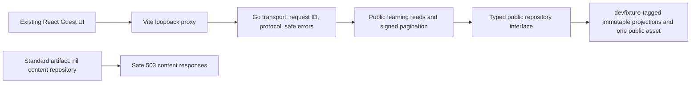

# VS-01A — Real Go API and Browser Integration

31 October 2026 · Local implementation and verification report · Evidence bundle `VS01A-INT-20261031`.

**Outcome:** API-001–005 and approved fixture media now serve the existing Guest UI through real Go HTTP responses in explicit development/test fixture mode. The original UI was preserved. Local Go, React, mocked-browser, real-browser, security-negative, and artifact-boundary checks pass. Hosted CI and independent review have not run for these uncommitted changes, so formal DD-001 completion and merge approval are not declared.

## A. Baseline, branch, and HEAD

| Check | Verified state |
|---|---|
| Repository / origin | `sipratama/ai-learning-platform` / `https://github.com/sipratama/ai-learning-platform.git` |
| Target branch | `feat/vs-01a-real-api-integration` |
| HEAD / merged main | `0e82158e812d4b50cef7fb187a44f7d4d54c81c4`, merge of the original Guest UI |
| Remote main | `git ls-remote` matched the baseline at preflight; no fetch or ref updates were used. |
| Initial worktree | Clean; required UI, fixture loader/guard, and API contract addendum present. |
| Authorization | Current Product Owner task explicitly authorizes VS-01A Foundation & Disposable Guest Proof. Historical planning-package status text is not silently rewritten. |
| Git operations | Read-only inspection only. No branch creation/switch, staging, commit, push, merge, rebase, or PR creation. |

Tests exercised the **uncommitted working tree above this baseline**, not a nonexistent implementation commit. [Verification metadata](evidence/verification-summary.json) records versions, test counts, and execution timestamps; [source manifest](evidence/source-manifest.json) binds the local source files to SHA-256 digests.

Authoritative inputs: [DP-02 acceptance criteria](../DP-02/05-acceptance-criteria.md), [MOD-002/003](../DP-03/02-module-boundaries-and-dependencies.md), [DP-04 public-read technical addendum](../DP-04/01-api-contract-and-resource-design.md), [security contracts](../DP-04/02-authentication-authorization-and-security.md), [functional scenarios](../DP-05/02-functional-integration-and-e2e-verification.md), [negative matrix](../DP-05/03-security-privacy-and-abuse-verification.md), [fixture/DR/DD contracts](../DP-06/03-vertical-slice-backlog-and-acceptance-contracts.md), and [QUAL gates](../DP-06/05-implementation-readiness-and-quality-gates.md). The [discovery report](../design-discovery/2026-10-31-ailene-inspired-vs01a.md) and [UI alignment report](../frontend/2026-10-31-vs01a-ui-alignment.md) remain historical design evidence.

## B. Go implementation and architecture



- `internal/publiclearning/model.go` holds the existing public DTO shapes and a narrow repository interface. The fixture aliases those DTO types instead of duplicating them. JSON names and semantics are unchanged. Private manifest records, safe-payload validation, and embedded data remain tagged.
- `service.go` applies search, membership filtering, title/ID ordering, bounded pagination, and same-snapshot metadata to fresh allowlisted projections. It never inspects private authoring/answer records.
- `cursor.go` generates a random 32-byte key using `crypto/rand` when the process-owned service is constructed. HMAC-SHA-256 authenticates the encoded payload; verification uses `hmac.Equal` and strict base64url/JSON decoding. No key is configured in the browser or emitted to HTTP/logs.
- Cursor bindings include endpoint, trimmed/case-normalized search, membership filter, effective limit, snapshot, and final lowercased title/canonical ID. Tampering, changed bindings, and reset keys produce 400. Identical valid GET replay intentionally returns the same page; there is no one-time cursor policy.
- `httpserver/public.go` handles the five routes and exact fixture-media allowlist. It validates decoded IDs, query syntax, methods, and Accept negotiation; it emits fixed safe problems. The existing middleware provides validated/generated request IDs and minimized structured logs. Panic recovery prevents internal panic text/stack disclosure.
- A 32-permit admission bound returns safe 429 when concurrent public work is saturated. This is bounded process backpressure, not a per-user rate quota or production SLA. It stores no client identity or forwarded-address buckets.
- Process startup chooses the repository through build-tag-specific composition. The standard implementation returns no content repository; the development implementation loads one immutable snapshot only when the explicit fixture mode and environment guards permit it.

No PostgreSQL/Supabase dependency, schema, migration, publishing workflow, Student state, or production synthetic fallback was added.

## C. API-001–005 compliance matrix

All responses use the documented field names. Successful content is JSON with `meta.requestId` and `meta.snapshotId`; lists additionally return `page.nextCursor`, normalized validated filters, and `sort:"title,id"`. Empty lists are `[]`, not `null`. Details do not acquire list metadata or private fields.

| API | Implemented behavior | Executed evidence | Result |
|---|---|---|---|
| API-001 `/api/v1/catalog/paths` | Published/discoverable Paths; `q`, `courseId`, `limit`, `cursor`; visible counts and stable title/ID ordering. | `TestAPI001Through005Success`, `TestVS01AN01CatalogVisibilityAndFilters`, signed pagination tests, real FT journey. | PASS |
| API-002 `/api/v1/catalog/courses` | Same public visibility; `q`, `pathId`, `limit`, `cursor`; hidden Path filter yields empty without confirming existence. | Same HTTP suite; real membership/search and pagination suite. | PASS |
| API-003 `/api/v1/paths/{pathId}` | Published Path detail, ordered public member Courses with canonical IDs; no query/version selector. | Success, hidden/invalid-ID, DTO, real Path navigation tests. | PASS |
| API-004 `/api/v1/courses/{courseId}` | Public Course/Module/free Lesson hierarchy from the snapshot; no enrollment/progress/answer metadata. | Success and allowlisted DTO tests; real Course navigation. | PASS |
| API-005 `/api/v1/courses/{courseId}/lessons/{lessonId}` | Matching published Course version; free Lesson only; ordered safe Blocks; wrong Course pair/draft/nonfree unavailable. | HTTP mismatch/draft tests; repository nonfree test; real both-flagship-Lesson and rich-content tests. | PASS |

Shared input rules: default `limit=20`, range 1–50; trimmed `q` 1–100 Unicode code points when present; cursor ≤1024 characters; IDs 1–128 permitted ASCII characters. Unknown/duplicate keys, invalid UTF-8, controls, malformed escapes, unsupported sort/archive/version selectors, and invalid IDs fail with 400. Limits, Unicode boundaries, and ID boundaries are exercised. There is no search ranking or new archive/access policy.

Shared protocol rules: recognized public reads allow GET only; other methods receive 405 with `Allow: GET`. JSON or `*/*` Accept is supported; incompatible ranges, including explicit JSON `q=0`, receive 406. Missing/hidden/mismatched resources receive generic 404; saturated admission 429; injected internal failure 500; no configured repository 503. Problems use `application/problem+json`, fixed titles, and validated/generated request IDs. Reads/media use `Cache-Control: no-store` and `nosniff`.

## D. Frontend integration changes

- API base fallback now uses the page origin in both development and production. Existing absolute URL validation is preserved. Vite forwards `/api/v1` and `/assets/fixture` unchanged to an explicitly loopback HTTP backend target, default `127.0.0.1:8080`.
- Real browser verification uses Vite `15173` and Go `18081`, with explicit test environment settings. There is no permissive CORS addition and no need for browser service credentials.
- Search and membership keys, opaque cursor forwarding, cancellation, Path/Course/Lesson links, version checks, and local flashcard behavior remain intact. Unicode control detection now matches Go's control category; server-originated initial 400 errors can clear the invalid list parameters instead of retrying them indefinitely.
- **No styling/component redesign:** `apps/web/src/styles`, `apps/web/src/components`, and fixture manifest/media content have no diff against the baseline. The Reader now shows the actual existing Go-served SVG rather than the previous mocked media response; that is a data-source difference, not a new illustration.
- Mock test screenshots now write to ignored `test-results/mock-evidence`, preserving the earlier design report's historical PNGs.

No functional login, enrollment, Student progress, streak, achievement, certificate, quiz, or completion capability was introduced.

## E. Production fixture isolation evidence

[Artifact check output](evidence/fixture-boundary.txt) records the executed boundary script.

| Boundary | Actual verification |
|---|---|
| Standard dependency graph | `go list -deps ./cmd/api` excludes `internal/devfixture`. |
| Tagged dependency graph | `go list -tags devfixture -deps ./cmd/api` includes the fixture adapter. |
| Standard binary content | Private fixture marker, fixture identity, public SVG label, and private draft title are absent from the compiled standard binary. |
| Development binary content | Expected fixture markers exist, confirming that the standard comparison is meaningful. |
| Environment guard | Development artifact rejects staging/production even with fixture mode disabled; standard artifact rejects fixture activation. Existing configuration guards remain in force. |
| No standard fallback | Standard composition tests construct the real service/handler with no repository and verify safe 503 for all five reads plus fixture media. |
| Media boundary | Only `/assets/fixture/diagram.svg` is served by the tagged repository; traversal, encoded aliases, unknown assets, extra paths, and query-selected files are rejected. No generic file/directory server exists. |

The SVG is served with `image/svg+xml`, `nosniff`, `Cache-Control: no-store`, restrictive CSP (`default-src 'none'; sandbox`), and same-origin resource policy. Real browser natural width 240 confirms that the approved asset, not a test substitute, loaded through Go.

## F. Go test results

Go was initially absent from PATH. Official Go 1.27.3 for Darwin/arm64 was acquired into an isolated temporary tool directory and checked against the SHA-256 published in the [official Go download metadata](https://go.dev/dl/?mode=json&include=all). System PATH/global tool installations were not changed. The verified archive digest is recorded in the evidence summary.

| Executed command from `apps/api` | Actual result |
|---|---|
| `gofmt -w cmd internal`, then `gofmt -l .` verification | PASS; no remaining formatting output. |
| `go vet ./...` | PASS |
| `go vet -tags devfixture ./...` | PASS |
| `go test ./...` | PASS: 4 packages, 12 top-level tests, 31 passing events including subtests. [Record](evidence/go-standard.json) |
| `go test -tags devfixture ./...` | PASS: 5 packages, 28 top-level tests, 74 passing events including subtests. [Record](evidence/go-devfixture.json) |
| `go test -race ./...` | PASS; no race findings. [Record](evidence/go-race-standard.json) |
| `go test -race -tags devfixture ./...` | PASS; no race findings. [Record](evidence/go-race-devfixture.json) |
| `go build ./...` | PASS |
| `go build -tags devfixture ./...` | PASS |
| `GO_BIN=... bash scripts/check-fixture-boundary.sh` from root | PASS |
| `bash scripts/check-secrets.sh` from root | PASS for existing tracked-file guard. New source also reviewed for credential patterns. [Record](evidence/secret-guard.txt) |

The JSON test records list actual test identifiers and UTC start/finish times without raw private payloads, signing keys, or sensitive logs. Concurrent reads and saturation behavior are exercised separately: successful admitted concurrent reads are race checked; the blocked-repository test deterministically fills admission capacity and checks safe 429/release.

## G. React regression results

Node `22.23.4`, npm `10.9.9`, existing pinned frontend dependency graph. Runtime dependencies were not replaced.

| Command | Actual result |
|---|---|
| `npm run typecheck` | PASS, including both Playwright configs and test source. |
| `npm run lint` | PASS; new integration outputs are excluded as generated artifacts, not source exemptions. |
| `npm test` | PASS: 23 unit/component tests across four files. The added test covers Unicode C1 control rejection. |
| `npm run build` | PASS; no embedded fixture/test dataset in the production application. |
| `git diff --check` | PASS |
| `npm audit` | 0 Critical/High; 11 pre-existing Moderate development-tool findings. No runtime dependency additions. These advisories remain for separate toolchain review. |

The production bundle was checked for representative private/test fixture markers and the mocked dataset identifiers. Actual public content remains a Go response, not a Vite-bundled manifest.

## H. Mocked versus real Playwright results

| Mode | Processes / requests | Actual result / evidence |
|---|---|---|
| `npm run test:e2e:mock` (existing `test:e2e` alias preserved) | Existing fast DTO-intercepted UI contracts on desktop/tablet/mobile. | **24 passed**. [Mocked run log](evidence/mocked-playwright.txt). Does not establish Go behavior. |
| `GO_BIN=... npm run test:e2e:real` | Actual Go tagged build + actual Vite application; separate ports, no product API interception. | **10 passed**, five scenarios × desktop/mobile. [Real run log](evidence/real-playwright.txt). |

The real suite contains no `page.route`/`context.route` registration. Its response ledger verifies completed browser responses for all five endpoints, `pub-v1`, valid Go request IDs, and private-marker absence; a direct Go request additionally verifies the same published Course. Canceled StrictMode/navigation reads are not counted as completed evidence. Required completed endpoints are still explicitly asserted.

The runner owns the temporary compiled binary and both server processes. Playwright waits for readiness, does not reuse arbitrary existing servers, and terminates its servers after the suite. The runner deletes its temporary binary directory. No listener remained on 18081 or 15173 after completion. Runtime tests use only loopback services and self-hosted frontend assets.

Real HTTP metadata: [desktop](evidence/real-desktop-http.json), [mobile](evidence/real-mobile-http.json). Cursor values and signatures are not included in these ledgers. Eight normal-state axe checks reported zero violations in their automated coverage; keyboard skip/main focus, native mobile menu/Escape/return, and flashcard Enter/focus were exercised. This does not constitute complete WCAG certification or a manual screen-reader session.

All eight real screenshots below were directly inspected. The original visual hierarchy, sidebar, mobile composition, Reader width, and flashcard appearance remain intact.

| Screen | Desktop 1440×1000 | Mobile 390×844 |
|---|---|---|
| Catalog | [Capture](evidence/real-desktop-catalog.png) | [Capture](evidence/real-mobile-catalog.png) |
| Path Detail | [Capture](evidence/real-desktop-path.png) | [Capture](evidence/real-mobile-path.png) |
| Course Detail | [Capture](evidence/real-desktop-course.png) | [Capture](evidence/real-mobile-course.png) |
| Reader + local reveal | [Capture](evidence/real-desktop-reader.png) | [Capture](evidence/real-mobile-reader.png) |

## I. VS01A-N01–N17 security matrix

`PASS` describes the bounded VS-01A fixture and the named layers actually executed. It does not imply a production policy, future Student scenario, or every browser/device. Each row links to the executed Go record or browser log containing its test identifier. No row is marked passed solely from a source-code claim.

| Case | Layer / test identifier | Expected behavior | Actual result and evidence | Status |
|---|---|---|---|---|
| N01 | Go HTTP `TestVS01AN01CatalogVisibilityAndFilters`; real `ST-008 / N01–06,N14–17` | Hidden/draft items absent from list/search/counts; public filters deterministic. | Two public Paths/Courses, private-marker searches empty, hidden member filters empty; [Go](evidence/go-devfixture.json), [browser](evidence/real-playwright.txt). | PASS |
| N02 | Go HTTP `TestVS01AN02N03N04HiddenDraftAndMismatchedIDs`; real ST-008 | Hidden/absent Path/Course direct IDs return safe 404. | 404 with fixed problem fields, no private title; same generic UI recovery; [Go](evidence/go-devfixture.json), [browser](evidence/real-playwright.txt). | PASS |
| N03 | Same HTTP test; repository `TestNonFreeLessonNeverProjects`; loader validation | Draft/unpublished/nonfree Lessons do not project. | Draft 404; a test-only extra nonfree Lesson is absent from lookup/curriculum/free count; actual manifest unchanged; [Go](evidence/go-devfixture.json). | PASS |
| N04 | Same HTTP test; real ST-008 | Valid Lesson ID under the wrong Course is unavailable. | Flagship + focus Lesson pair returns generic 404, not focus content; [Go](evidence/go-devfixture.json), [browser](evidence/real-playwright.txt). | PASS |
| N05 | `TestVS01AN05N06AllowlistedDTOs`; real FT/ST-008 | No private assessment key/rubric in public data; authored flashcard back remains ungraded. | Response inventory excludes private markers/fields; real back reveal works and no official endpoint is created; [Go](evidence/go-devfixture.json), [browser](evidence/real-playwright.txt). | PASS |
| N06 | Same Go DTO test; original fixture projection tests | No draft/owner/author/private media/evidence metadata. | Typed projections retain exact public DTO fields; private records excluded across list/detail/Lesson reads; [Go](evidence/go-devfixture.json). | PASS |
| N07 | `TestVS01AN07N08N09QueryAndIDValidation`; real signed/search suite | Unknown, duplicate, malformed, unsupported, invalid-ID query inputs rejected. | Safe 400 for tested matrix, including malformed escapes/UTF-8 and archive/sort/version selectors; [Go](evidence/go-devfixture.json), [browser](evidence/real-playwright.txt). | PASS |
| N08 | Same HTTP test | Enforce documented q/limit/cursor/ID bounds without raw input disclosure. | q=100 Unicode accepted, q=101 rejected; limit 1/50 accepted, 0/51 rejected; oversized cursor/ID rejected; [Go](evidence/go-devfixture.json). | PASS |
| N09 | Same HTTP test; real signed cursor scenario | Malformed cursor gives safe 400 and correlation. | Invalid encoding/shape rejected through common safe problem middleware; [Go](evidence/go-devfixture.json), [browser](evidence/real-playwright.txt). | PASS |
| N10 | `TestVS01AN10N11SignedPaginationAndReset`, `TestCursorAuthenticationAndBindings` | Tampering and cross endpoint/filter/limit/snapshot/reset reuse rejected. | HMAC tampering 400; actual binding changes 400; authentic old-snapshot cursor with same test key rejected; fresh service key rejects old token; valid identical replay remains safe; [Go](evidence/go-devfixture.json), [real](evidence/real-playwright.txt). | PASS |
| N11 | Same Go pagination test; `TestStableTitleIDOrderingAndNormalizedQuery`; real signed pagination | limit=1 traverses visible IDs once in title/ID order. | No duplicate/skip; tie ordering and normalized search verified; final cursor null; [Go](evidence/go-devfixture.json), [real](evidence/real-playwright.txt). | PASS |
| N12 | Fixture payload tests; React safe-Markdown tests; real `ST-013 / N12–13` | Script/event/unsafe URI content remains rejected or inert; literal code readable. | Loader rejects unsafe authored public probes; existing renderer negatives pass; actual Go-served script-shaped code stays literal with no dialog/script DOM; [Go](evidence/go-devfixture.json), [real](evidence/real-playwright.txt). | PASS |
| N13 | `TestVS01AN12N13SafeContentAndMedia`; fixture/React negative tests; real ST-013 | Only controlled public asset loads; traversal/private/unsafe sources rejected. | Exact asset 200 with security headers, width 240 in real browser; unknown/traversal/encoded alias rejected; unsafe URL payloads rejected/inert; [Go](evidence/go-devfixture.json), [real](evidence/real-playwright.txt). | PASS |
| N14 | `TestVS01AN14N15N16RequestIDsProblemsAndLogs`; existing request-ID tests; real ST-008 | Valid ID echoed, malformed/duplicate/overlength ID replaced; header/body correlation. | Valid 64-char bound accepted; invalid, control-containing handler inputs, duplicates and 65-char values replaced; real printable invalid header replaced; [Go](evidence/go-devfixture.json), [HTTP ledger](evidence/real-desktop-http.json). | PASS |
| N15 | Same Go test + `TestVS01AN15Safe500AndBounded429`; real error recovery | 400/404/500 problems contain no internals and permit recovery. | Fixed `about:blank` problems, correlation, no stack/private marker; injected panic 500 safe; real hidden error returns to catalog; [Go](evidence/go-devfixture.json), [real](evidence/real-playwright.txt). | PASS |
| N16 | Same log/panic tests + existing `TestSafeErrorsAndRedactedLogs` | Logs exclude tokens, rejected IDs, raw query/body, and private fields. | Synthetic sensitive header/query/body/panic markers absent; structured logs contain only safe event/outcome/correlation/timing; [Go](evidence/go-devfixture.json). | PASS |
| N17 | `TestUnknownOfficialRoutesRemainAbsent`; React flashcard tests; real ST-008/FT-003 | Local interaction/reload/tampering cannot create official state. | Reveal resets on reload; injected local completion flag ignored; official evidence/completion requests 404 and Course DTO has no such fields; [standard](evidence/go-standard.json), [real](evidence/real-playwright.txt). | PASS |

Malformed wire-level HTTP headers may be rejected by Go's HTTP parser before middleware; handler-level invalid-value regeneration and real printable-invalid-header behavior are distinguished above. The all-free published fixture has no ordinary positive 403 branch; the documented hidden/nonfree lookup result is 404. No new entitlement policy was invented to manufacture a 403 test.

## J. FT-001–003 / ST-008 evidence

| Scenario | Actual demonstrated behavior | Evidence |
|---|---|---|
| FT-001 | Real catalog search, public membership filter, safe no-match state/reset, and actual signed pagination. | `FT-001 / N07–11` in [real log](evidence/real-playwright.txt); Go filter/pagination tests. |
| FT-002 | Real Path → canonical Course → first and second free flagship Lesson without login, same published snapshot. | `FT-001–003` in [real log](evidence/real-playwright.txt); both [HTTP ledgers](evidence/real-desktop-http.json); actual Reader captures. |
| FT-003 | Local keyboard reveal, authored explanation, reload collapse, no official outcome despite a forged local flag. | Real FT journey/ST-008 tests; unchanged component tests and official-route absence tests. |
| ST-008 | Hidden/draft/mismatched direct URLs denied; private keys/titles/draft metadata absent from public projections/JSON/DOM. | Go visibility/DTO suite; real ST-008; no private raw evidence is published. |

## K. CI changes and hosted status

[GitHub Actions](../../.github/workflows/ci.yml) now configures standard/tagged vet, tests, both race variants, both builds, artifact boundary checks, React type/lint/unit/build, separately named mocked/real Playwright modes, and the secret guard. Go `1.27.3`, Node `22.23.4`, and Playwright `1.64.1` through the locked package graph select the tool/browser versions. CI installs the Playwright-pinned Chromium revision; the local run used the existing Chrome version stated in the evidence.

Permissions remain `contents: read`. Browser reports, traces, and redacted integration evidence are uploaded for review with bounded retention. There is no deployment workflow or production secret requirement.

**Hosted CI: NOT RUN for this working tree.** No commit/push/PR was made, and local command success is not represented as a hosted job result.

## L. Security findings and remediation

- The baseline's missing real public transport and integration evidence were completed without bypassing the fixture owner or importing private manifest data into React.
- Duplicate request-ID headers are now treated as invalid rather than ambiguously accepting the first value.
- Signed cursor verification rejects altered payload/signature and every tested context mismatch. Keys are newly generated on service initialization and never persisted to source/browser/logs.
- Public media exposure is an exact tagged allowlist with no filesystem traversal or directory access. The existing fixture manifest and asset bytes are unchanged.
- Initial frontend 400 recovery now clears invalid parameters; Unicode C1 controls are detected consistently with the Go query boundary. Existing design components/styles are unchanged.
- An initial **test instrumentation** issue attempted to read bodies after StrictMode/navigation cancellation. The recorder now excludes canceled body reads while still requiring completed evidence for all five endpoints. It does not relax API or security assertions.
- No Critical/High finding was identified in this bounded implementation and executed negative coverage. Eleven Moderate development-tool advisories from the existing frontend toolchain remain; no forced downgrade or unrelated package change was made.

This is an agent self-review with executed evidence, not independent security approval or penetration testing of a production environment.

## M. DD-001 / QUAL assessment

| Gate | Assessment |
|---|---|
| DR-001 / QUAL-007 | Current task explicitly authorizes VS-01A; correct clean baseline and no predecessor verified. Open archive/migration/prerequisite-policy GAP branches remain excluded. |
| QUAL-008 | Public DTO/query/security/fixture contracts followed without policy/schema changes. Source trace appears in this report and original contracts. |
| QUAL-009 | Real isolated environment now exercised with pinned Go, local fixture snapshot, explicit flags/ports, deterministic process ownership, and no production credentials. Local PASS. |
| QUAL-010 / 012 / 013 | Standard/tagged unit, concurrency/race, API protocol/security/query/cursor checks PASS locally. |
| QUAL-014 / 015 | React regression, mocked browser contracts, real Go/React browser journeys, and the bounded negative matrix PASS locally. |
| QUAL-011 / 016 | PostgreSQL/migrations/Student lifecycle not applicable to this development-only immutable fixture increment. No production persistence proof is claimed. |
| DD-001 / QUAL-003 | Implementation and local evidence are ready for domain/security/quality review. **Formal completion remains pending independent review and applicable CI approval. VS-01A is not declared DONE by this report.** |
| QUAL-004–006 | PR/merge, deployment, and beta Go/No-Go remain separate Product Owner decisions; not performed. |

No documentation gate, local pass count, or screenshot replaces formal review or release authority. Field Web Vitals, ≥90% usability studies, broad WCAG certification, and future production recovery are not asserted by this proof.

## N. Remaining blockers and risks

1. Hosted CI and independent PR/security/domain review remain outstanding. The code is intentionally uncommitted; the Product Owner controls subsequent Git operations.
2. Production content is deliberately unavailable without a future governed content repository/publishing path. Standard artifact 503 is expected behavior, not a fixture fallback defect.
3. Real local browser evidence covers Chrome desktop/mobile; physical devices, Safari/Firefox, native zoom UI, and manual screen-reader sessions remain outside the demonstrated coverage. Existing mocked tests retain tablet/reflow/text-resize coverage.
4. The existing 11 Moderate development dependency findings need separate reviewed toolchain work. No production dependency was added in this task.
5. Local Go was installed into a temporary isolated directory because PATH lacked it. Reproduction elsewhere requires Go 1.27.3 on PATH or an explicit `GO_BIN`. Browser/package acquisition requires normal installation access; runtime integration tests themselves require only loopback services.
6. The fixture is a deliberately small synthetic snapshot, not complete production course content or a publishing mechanism. Open product-policy GAPs remain open.

## O. Changed files and Git status

See [Git status](evidence/git-status.txt) and the [source digest manifest](evidence/source-manifest.json). Changes are confined to authorized Go transport/application/fixture wiring/tests, frontend integration/test configuration, CI/boundary checks, and documentation/evidence.

- Go: `cmd/api/{main,fixture_dev,fixture_prod,fixture_prod_test}.go`; fixture public type aliases plus new repository/negative test; new `internal/publiclearning/{model,service,cursor,cursor_test}.go`; HTTP middleware and new public transport/contract tests.
- Frontend: API fallback/control validation and tests, main fallback, initial-400 recovery, Vite loopback proxy/watch exclusions, `.env.example`, scripts/TypeScript/output-ignore configuration, existing mock screenshot destination, and separate real integration config/runner/spec.
- Delivery/docs: GitHub Actions, fixture-boundary marker coverage, root/frontend READMEs, this report and redacted local evidence.
- Unchanged: fixture manifest/media bytes, frontend design components/styles, backend configuration classification/guards, public API contract documents, and all Student/Admin capability boundaries.

Branch and HEAD remain the preflight values; staged changes are absent. No Git write operations were performed. The final dirty worktree contains the reviewable implementation and new evidence.

## P. Recommended Conventional Commit

```text
feat(vs01a): integrate real Go public reads with the Guest UI
```

Suggested body: serve allowlisted development content through the five existing contracts, authenticate pagination cursors, retain production fixture exclusion, proxy the existing React UI locally, and add real Go/React browser plus security/CI evidence. Explicitly keep production content, official learning state, and release approval outside scope.

## Q. Product Owner PR and merge checklist

- [ ] Confirm the intended branch/baseline, current VS-01A authorization, uncommitted source digest, and excluded GAP branches.
- [ ] Review typed DTO extraction/aliases; confirm no response field, query bound, visibility rule, or product policy changed.
- [ ] Review HMAC key generation, strict verification, endpoint/filter/limit/snapshot/last-key binding, and safe repeat/reset behavior.
- [ ] Reproduce standard/tagged vet/test/race/build checks and binary/dependency/startup boundaries with Go 1.27.3.
- [ ] Review 23 React tests, 24 mocked browser tests, 10 real Go/React browser tests, and the N01–N17 evidence table.
- [ ] Confirm real tests have no interception of product endpoints; inspect response ledgers, approved media delivery, and all eight real screenshots.
- [ ] Confirm original UI source styles/components and fixture content remain unchanged; no login, progress, achievements, grading, or completion endpoint exists.
- [ ] Review logging/error/media safety and existing Moderate development-tool advisories; resolve any new material findings before approval.
- [ ] Run the configured hosted CI after the Product Owner's authorized commit/push/PR workflow and inspect actual artifacts/results.
- [ ] Complete independent domain/security/quality review and formally assess DD-001; do not infer beta approval from this local proof.
- [ ] Keep merge, deployment, and any later production publishing/storage work under separate authorization.

**Stop point:** authorized implementation, feasible local verification, self-review, and reporting are complete. No commit, push, merge, PR creation, or deployment was performed.
